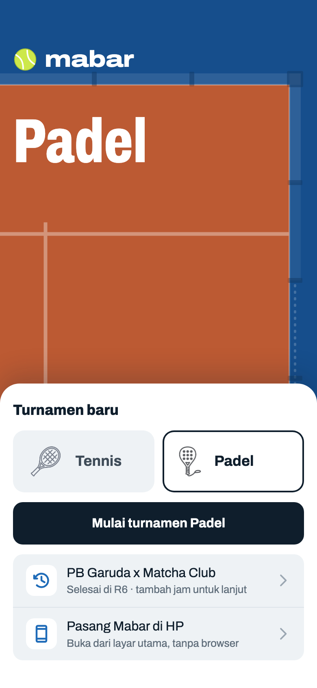
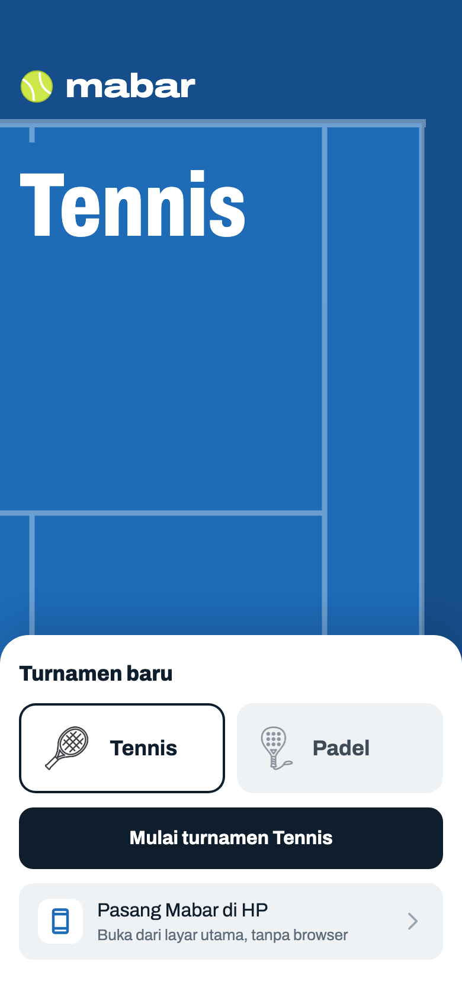
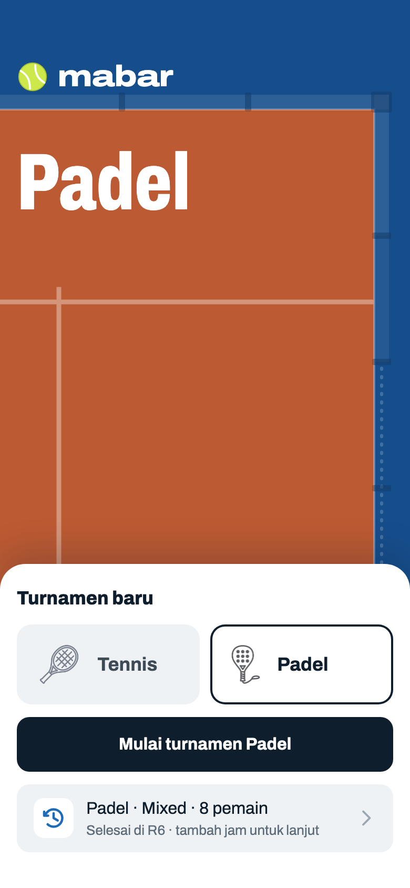
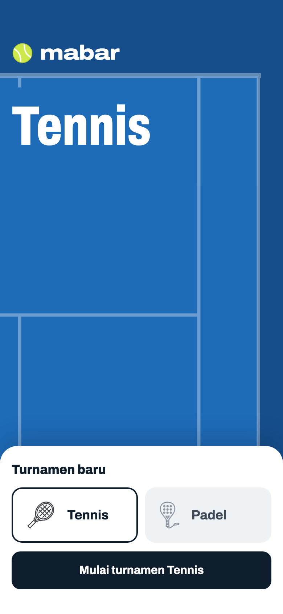
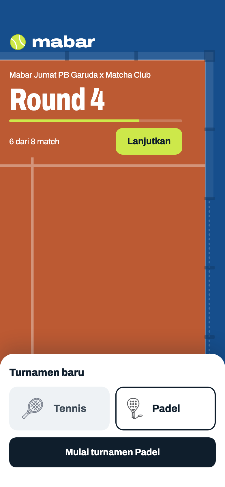
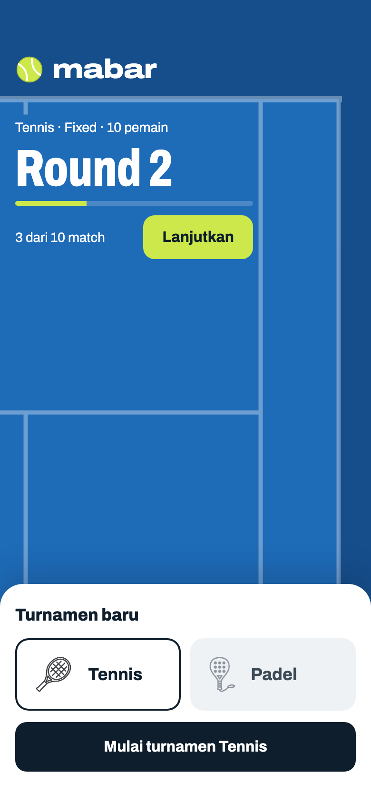
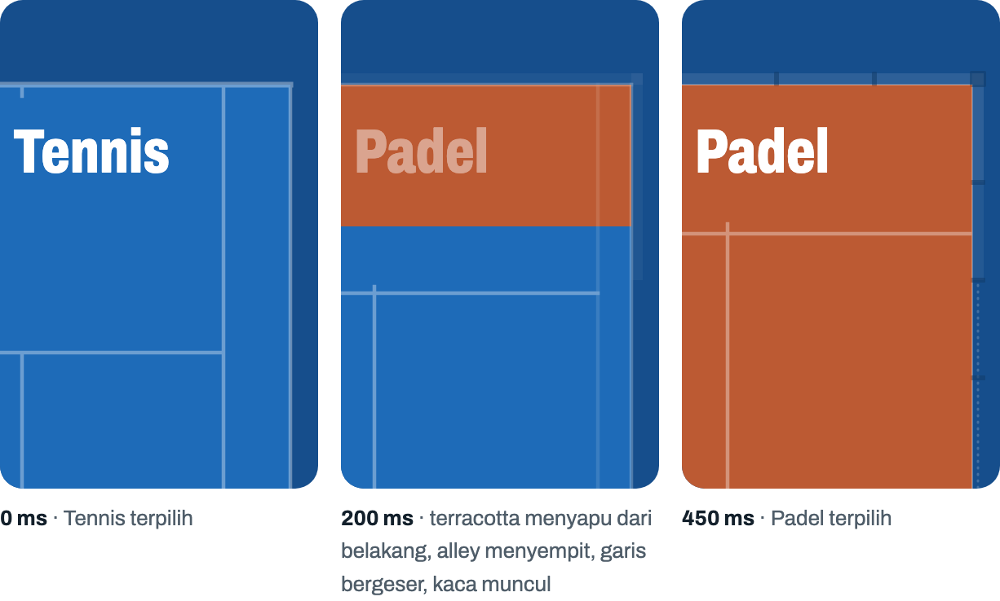
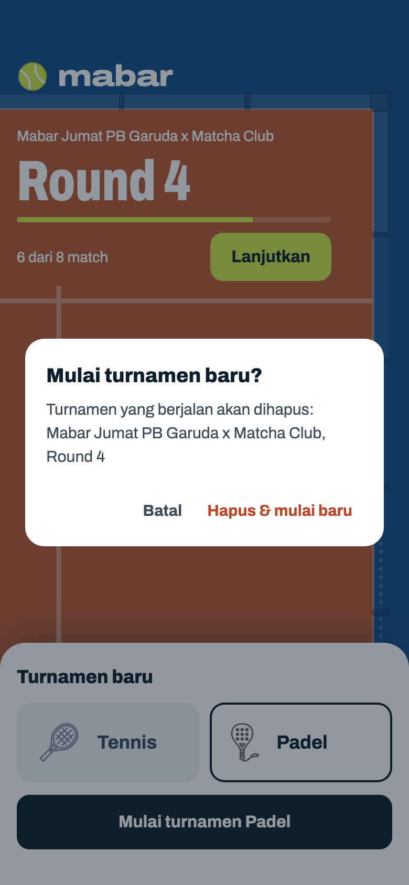
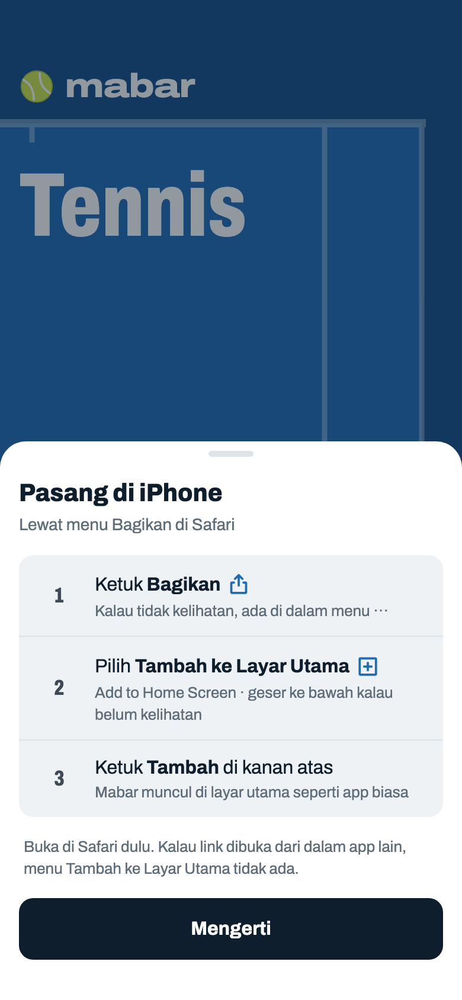
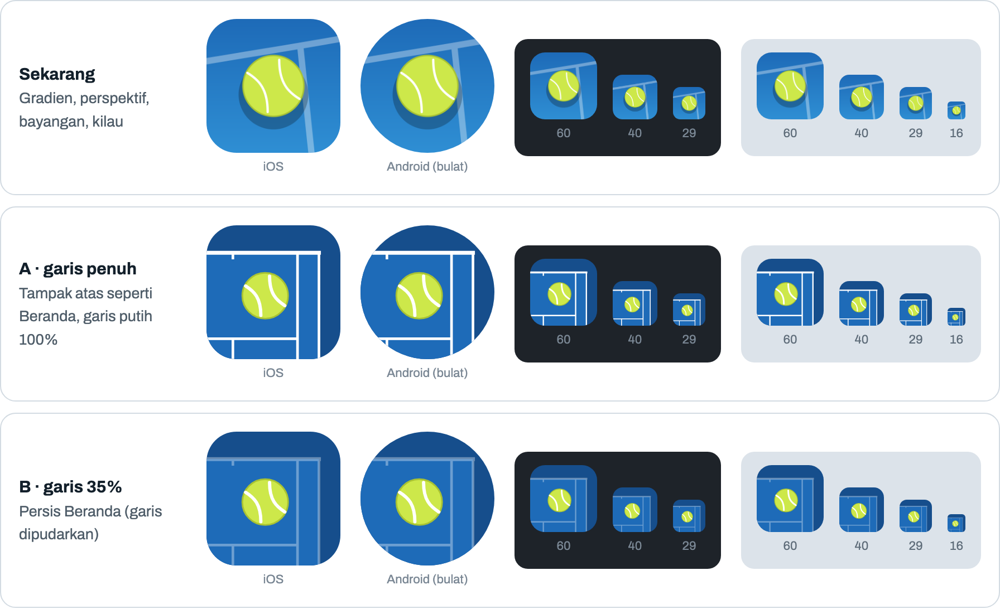

# Beranda

> Dihasilkan `tool/hifi_extract.py` dari `design/hifi.html`. Jangan diedit langsung.

Lapangan di atas, panel main di bawah (zona jempol), seperti layar mulai di aplikasi olahraga. Banner selalu menggambar lapangan olahraga yang sedang dipilih atau dimainkan, dengan proporsi asli pada skala 60 pt = 1 m. Garis dipertebal (baseline 7 pt, garis lain 4,5 pt) tapi dipudarkan ke 35% sebagai satu lapisan, jadi lapangan terbaca sebagai latar dan teks putih di atasnya tetap paling menonjol. Permukaan tennis biru court, padel terracotta; run-off di luarnya tetap biru tua di keduanya, jadi pergantian olahraga terbaca dari hangat-dinginnya warna tanpa mengganti bingkai. Lapangan mengisi sisa tinggi layar, jadi tinggi banner menyesuaikan isi panel di setiap kondisi.

## 01a · Belum terpasang + ada riwayat · bernama

Komponen: `MabarButton`, `MabarGroup / MabarRow`, `CourtBanner (CourtPainter)`, `HomePanel / SportPicker`

- Kondisi terlengkap: web/PWA belum dipasang dan ada turnamen terakhir (Mixed). Dua baris dalam satu grup: riwayat dulu, lalu pasang.
- Pilihan olahraga diingat dari turnamen terakhir, jadi Padel terpilih dan banner menggambar lapangan padel.
- Riwayat → sheet Lanjutkan turnamen (08c, `archived: true`). Pasang → dialog pasang bawaan browser (`prompt`) atau sheet 01i (`manual`, iPhone/iPad).
- Turnamen bernama: nama menggantikan "Padel · Mixed · 8 pemain" di baris riwayat (satu baris, elipsis); subjudul tetap. Tanpa nama: "Padel · Mixed · 8 pemain" seperti 01c.

## 01b · Belum terpasang saja

Komponen: `MabarButton`, `MabarGroup / MabarRow`, `CourtBanner (CourtPainter)`, `HomePanel / SportPicker`

- Belum pernah ada turnamen: default Tennis. Hanya baris pasang.
- Baris pasang hanya di web: mode `none` (native, sudah terpasang, browser tanpa dukungan) menyembunyikannya. Bisa muncul belakangan karena event browser datang terlambat, dan hilang setelah dialog pasang ditutup.
- Nama olahraga dicat besar di dalam service box, seperti tulisan di lapangan sungguhan. Tidak ada tagline atau statistik.

## 01c · Ada riwayat saja

Komponen: `MabarButton`, `MabarGroup / MabarRow`, `CourtBanner (CourtPainter)`, `HomePanel / SportPicker`

- App sudah terpasang (atau native), ada turnamen terakhir Mixed. Hanya baris riwayat.
- Turnamen terakhir Fixed tidak tampil karena tidak bisa dilanjutkan.
- Gimmick: banner padel menggambar dinding kaca belakang dan samping (tiang tiap panel 2 m), kaca samping menurun bertingkat, jaring titik-titik setelah 4 m, service line 3,05 m dari dinding yang membentang penuh, dan center line yang menonjol 20 cm. Tidak ada alley dan baseline bercat.
- Permukaan padel terracotta `#BC5A33`: pasangan komplementer dengan run-off biru tua, beda kecerahannya cukup jauh sehingga tepinya tidak bergetar. Tennis tetap biru karena bola paling kontras di biru dan biru court adalah warna ikon app.

## 01d · Terpasang · belum ada riwayat

Komponen: `MabarButton`, `CourtBanner (CourtPainter)`, `HomePanel / SportPicker`

- Instalasi baru: tidak ada turnamen berjalan, tidak ada riwayat, sudah dipasang. Panel hanya pilihan olahraga dan tombol mulai; lapangan mengisi layar paling luas.
- Tombol mulai → layar Pemain dengan olahraga terpilih.

## 01e · Turnamen berjalan · Padel · bernama

Komponen: `MabarButton`, `CourtBanner (CourtPainter)`, `HomePanel / SportPicker`

- Banner mengikuti olahraga turnamen yang berjalan. Info round ditulis di zona belakang, antara dinding dan service line. Baris riwayat tidak tampil (slot aktif dan terakhir tidak muncul bersamaan).
- "Lanjutkan" (bola) membuka Jadwal dengan config tersimpan apa adanya. "Mulai turnamen…" tetap tombol utama yang sama; karena akan menghapus turnamen ini, dialog 01h muncul dulu.
- Kalau di web dan belum terpasang, baris pasang tetap tampil di bawah tombol seperti 01b.
- Tombol Lanjutkan 46 pt (lebih rendah dari tombol biasa 52) supaya muat di zona belakang lapangan.
- Semua teks di banner putih penuh, termasuk subjudul dan "6 dari 8 match" (dulu 78% dan 85%). Di terracotta putih penuh 4,5:1; putih 85% hanya 3,7:1.
- Turnamen bernama: nama menggantikan baris kecil di atas "Round 4" (satu baris, elipsis; 40 karakter masih muat). Tanpa nama: "olahraga · mode · n pemain" seperti 01f.

## 01f · Turnamen berjalan · Tennis

Komponen: `MabarButton`, `CourtBanner (CourtPainter)`, `HomePanel / SportPicker`

- Info round ditulis di dalam kotak singles, antara baseline dan service line, sehingga tidak menyentuh garis alley.
- Fixed menampilkan total match sejak awal (round-robin penuh sudah dibuat): 3 dari 10 match. Mixed hanya menghitung round yang sudah dibuat.
- Perilaku tombol sama dengan 01e: Lanjutkan → Jadwal Fixed; Mulai turnamen → dialog 01h.

## 01g · Transisi Tennis → Padel (skala 1:2)

Komponen: `CourtBanner (CourtPainter)`

- Satu animasi 450 ms, `Curves.easeInOutCubic`, dijalankan saat tile berganti (arah dibalik untuk Padel → Tennis). Tidak dijalankan saat ada turnamen berjalan, karena banner mengikuti turnamen itu.
- Garis bergerak, bukan ganti gambar: singles sideline menyatu ke sideline luar dan hilang; baseline menipis jadi tepi dinding; service line bergeser dari 5,485 m ke 3,05 m dari belakang; center line bergeser ke tengah lebar padel dan memanjang 20 cm. Kaca, tiang, dan jaring muncul dengan fade di 60% terakhir.
- Warna permukaan tidak dicampur bertahap: biru ke terracotta lewat abu-abu ungu di tengahnya. Warna olahraga baru menyapu dari baseline/dinding belakang ke bawah dengan tepi tegas, seperti lapangan dicat ulang, pada kurva yang sama (di 200 ms ±37% tinggi lapangan). Run-off tidak berubah.
- Nama olahraga crossfade di tempat yang sama: nama lama sudah hilang di 30% pertama perjalanan garis (dua kata tidak bertumpuk), nama baru muncul mengikuti kurva yang sama. Dengan `reduce motion`: crossfade 150 ms saja (garis, warna, dan nama).
- Diganti lagi di tengah animasi: garis lanjut dari posisinya sekarang menuju olahraga yang baru dipilih (tidak meloncat).
- Implementasi: satu `CustomPainter` dengan parameter `t` 0–1, dipakai bersama generator ikon app. Pudar 35% lewat satu `saveLayer` beropasitas di atas warna court (bukan opasitas per garis, supaya persilangan tidak lebih terang); ikon app memakai painter yang sama dengan opasitas penuh karena kecil.

## 01h · Dialog · mulai turnamen baru

Komponen: `MabarButton`, `MabarTextButton`, `showMabarSheet`, `showMabarConfirm`, `CourtBanner (CourtPainter)`, `HomePanel / SportPicker`

- Slot aktif cuma satu. "Hapus & mulai baru" lanjut ke layar Pemain dengan olahraga yang dipilih di panel.
- Baru: isi dialog menyebut turnamen mana yang akan hilang.
- Dialog menyebut nama turnamen kalau ada (boleh dua baris); tanpa nama "Padel · Mixed, Round 4".

## 01i · Sheet · pasang di iPhone

Komponen: `MabarButton`, `MabarGroup / MabarRow`, `showMabarSheet`, `CourtBanner (CourtPainter)`, `HomePanel / SportPicker`, `InstallStep`

- Dari baris pasang di iPhone/iPad (iPad terdeteksi sebagai Mac + layar sentuh). Di tab Safari status terpasang tidak bisa diketahui, jadi barisnya tetap muncul.

## 01j · Ikon app · dipilih A (garis penuh)

- Sumbernya painter yang sama dengan banner Beranda: sudut lapangan tennis tampak atas proporsi asli (alley 1,37 m, service line 5,485 m dari baseline, center mark), warna court + run-off court-deep, dan bola brand di service box. Tanpa gradien, perspektif, bayangan, atau kilau.
- Ikon selalu tennis biru (identitas brand), tidak berubah ke padel.
- Android adaptive: latar = lapangan + garis, foreground = bola. Bola berada di dalam safe zone 66%, jadi tetap utuh di mask bulat, squircle, maupun kotak.
- Ukuran kecil (29–16 px) yang menentukan: di A garis masih terbaca sebagai lapangan; di B garis hilang dan yang tersisa kotak biru + bola.
- Setelah dipilih: `tool/generate_app_icon.dart` me-render painter ini lalu `flutter_launcher_icons` seperti sekarang; favicon dan ikon PWA ikut.
