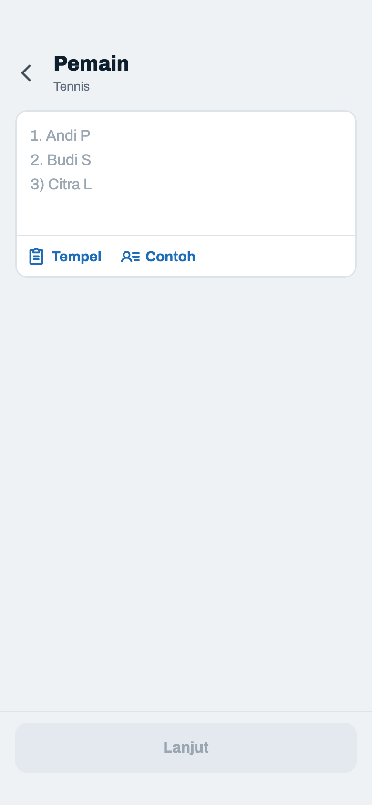
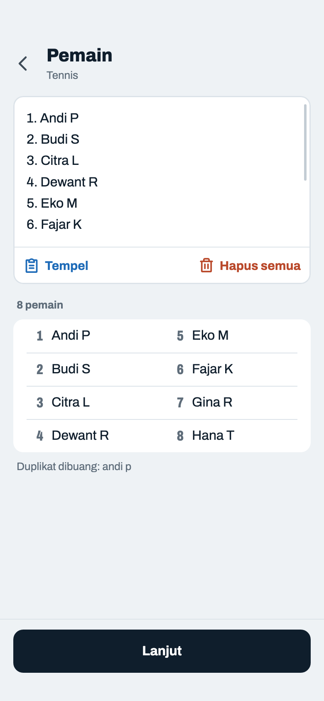
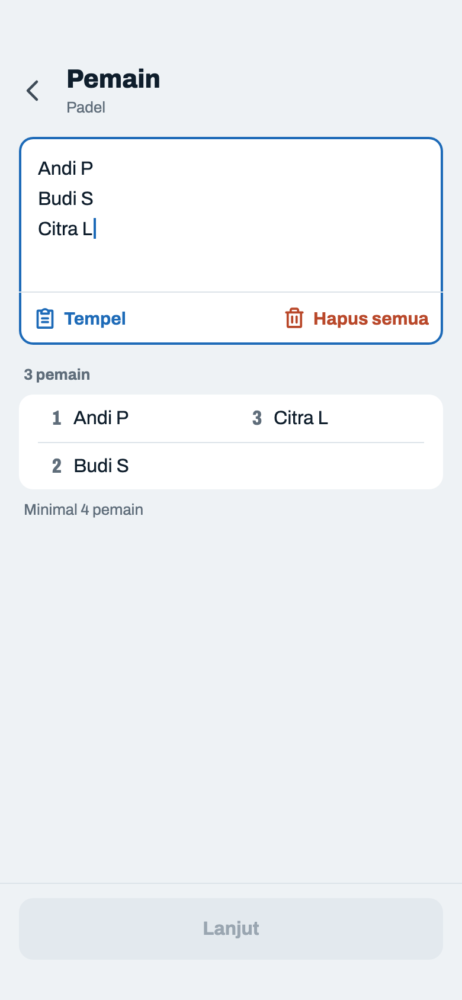
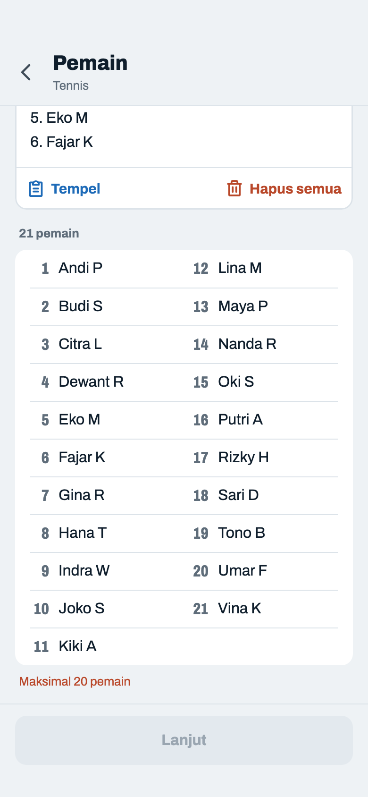

# Pemain

> Dihasilkan `tool/hifi_extract.py` dari `design/hifi.html`. Jangan diedit langsung.

Satu kotak teks untuk ditempel dari grup WhatsApp, dengan aksinya menempel di bawah kotak. Penomoran dan bullet dibersihkan diam-diam; daftar bernomor di bawahnya menunjukkan hasil akhirnya.

## 02a · Kosong

Komponen: `MabarAppBar`, `MabarButton`, `MabarTextButton`, `MabarIconButton`, `MabarActionBar`, `MabarField`, `NameListField`

- Tidak autofocus: jalan utamanya Tempel dari grup WhatsApp, jadi keyboard tidak langsung menutupi layar.
- Kotak teks 4–6 baris lalu scroll di dalam (dulu 5–8); daftar lengkapnya terbaca di bawah, jadi kotaknya tidak perlu tinggi. Keyboard multiline, huruf awal tiap kata kapital.
- Aksi menempel di bawah kotak teks sebagai toolbar `.txtbtn` (teks biru + ikon 20), bukan chip.
- "Contoh" (8 nama contoh) hanya ada saat kosong, karena ia mengganti seluruh isi; kalau tetap ada saat terisi, satu ketukan salah menghapus daftar host. Toolbar paling banyak dua tombol, jadi muat juga di HP 360 dp.
- Subjudul penjelas dan baris "Boleh pakai 1. 2) -" dihapus. Parser tetap membuang `1.` `2)` `03 -` `4:` `-` `*` `•`, spasi ganda, dan baris kosong.

## 02b · Terisi · ada duplikat

Komponen: `MabarAppBar`, `MabarButton`, `MabarTextButton`, `MabarIconButton`, `MabarActionBar`, `MabarGroup / MabarRow`, `NameListField`, `RosterPreview`

- Hasil parser tampil sebagai daftar bernomor dua kolom (`.roster`), urut ke bawah dulu. Nomornya memastikan penomoran dari WhatsApp sudah dibuang dan jumlahnya pas; kolom rata membuat 20 nama tetap rapi, tidak seperti chip yang membungkus tidak rata.
- Teks berisi 9 baris; kotak menampilkan 6 dan sisanya di-scroll (garis scroll di kanan).
- Duplikat (tidak peka huruf besar) tidak masuk daftar; yang pertama dipertahankan. Namanya disebut di catatan bawah, seperti sekarang.
- Setelah ada isi, toolbar: Tempel + Hapus semua. "Tempel" menambahkan di baris baru (kalau kosong, mengganti isi). "Hapus semua" langsung mengosongkan tanpa konfirmasi, dan Contoh muncul lagi.
- Jumlah ditulis sekali di label daftar; tombol cukup "Lanjut" → Konfigurasi dengan olahraga + daftar pemain.

## 02c · Jumlah belum memenuhi

Komponen: `MabarAppBar`, `MabarButton`, `MabarTextButton`, `MabarIconButton`, `MabarActionBar`, `MabarGroup / MabarRow`, `MabarField`, `NameListField`, `RosterPreview`

- Daftar dan jumlahnya diperbarui tiap ketikan. Kurang dari 4 bukan error (host masih mengetik), jadi catatannya abu-abu, bukan clay.
- Tombol mati sampai jumlahnya 4–20.

## 02d · Lebih dari 20 · halaman di-scroll

Komponen: `MabarAppBar`, `MabarButton`, `MabarTextButton`, `MabarIconButton`, `MabarActionBar`, `MabarGroup / MabarRow`, `NameListField`, `RosterPreview`

- Di atas 20 pemain halaman di-scroll; app bar dan action bar tetap. Daftar tetap menampilkan semua nama supaya host bisa memilih siapa yang dihapus dari kotak teks.
- Catatan clay "Maksimal 20 pemain" menggantikan "Minimal 4", sama seperti pesan error di Konfigurasi. Daftarnya tidak ikut diwarnai. Tombol mati.
- Begitu konten ter-scroll ke bawah app bar, app bar mendapat garis tipis di bawahnya.
- Nama panjang dipotong elipsis di kolomnya; nama lengkapnya tetap tersimpan.
