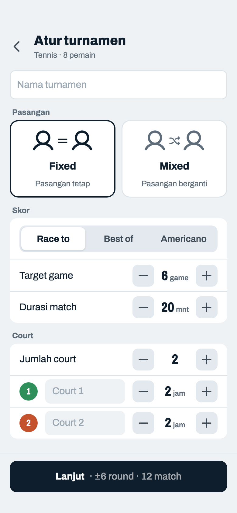
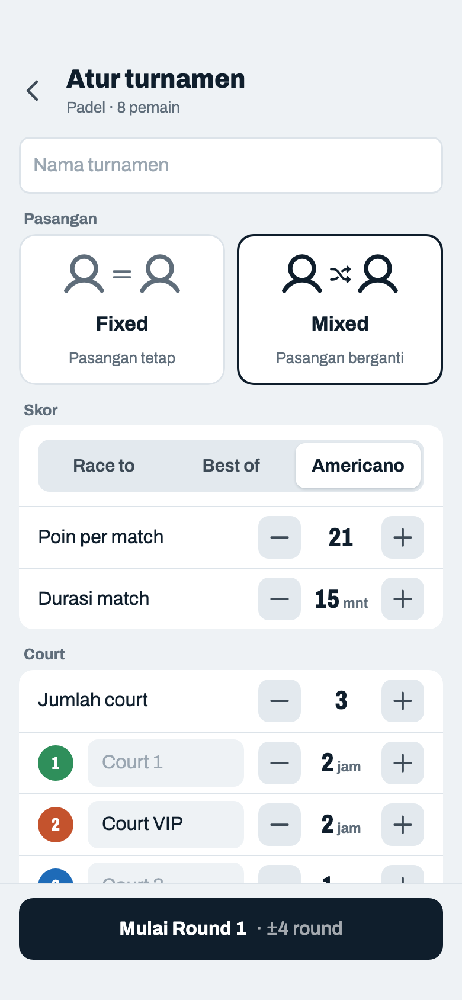
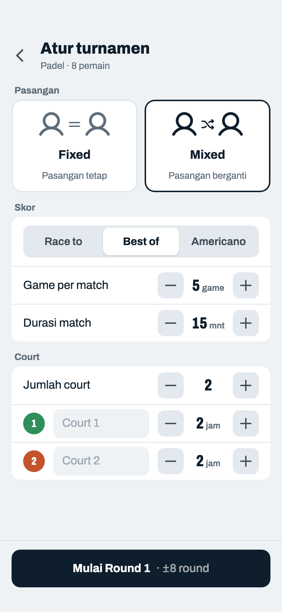
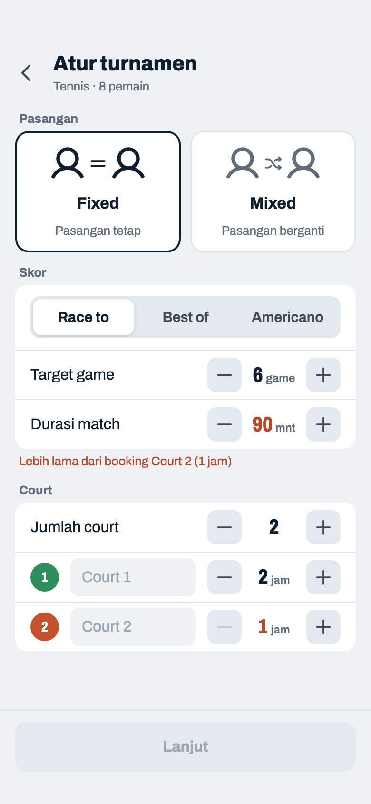
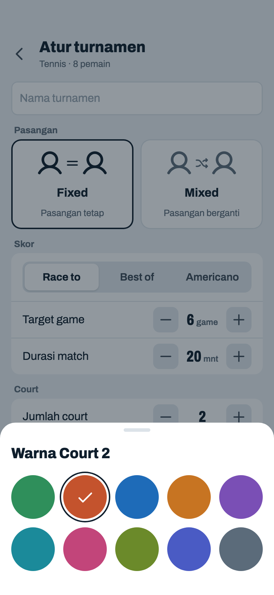

# Konfigurasi

> Dihasilkan `tool/hifi_extract.py` dari `design/hifi.html`. Jangan diedit langsung.

Disusun seperti halaman pengaturan dan muat satu layar. Skor punya tiga format yang dipakai di mabar tennis maupun padel: Race to, Best of, dan Americano. Estimasi pindah ke tombol. Untuk Mixed, layar "Cara Kerja Mixed" dihapus: tombol langsung membuat Round 1, dan aturan fairness serta estimasi pindah ke sheet 06k.

## 03a · Fixed · Race to 6

Komponen: `MabarAppBar`, `MabarButton`, `MabarIconButton`, `MabarActionBar`, `MabarGroup / MabarRow`, `MabarSegmented`, `MabarStepper`, `MabarField`, `ModePicker`, `CourtColorPicker`

- Default kedua olahraga: Race to 6, durasi 20 mnt (Padel 15 mnt), 2 court × 2 jam.
- Durasi match selalu kelipatan 5 menit (minimal 5): stepper ±5, dan angka yang diketik langsung dibulatkan ke kelipatan 5 terdekat.
- Race to N: siapa duluan menang N game. Target 2–9 (4 = gaya Fast4, 6 = satu set, 8 = pro set). Skor akhir yang diterima: N lawan 0..N−1; match langsung selesai begitu satu tim mencapai N (di dalam game tetap 15–30–40). Tidak ada 7–5 / 7–6 (keputusan host 2026-10-22).
- Kartu mode: ilustrasi dari ikon Phosphor (`user` + `equals` / `shuffle` + `user`), ukuran orang identik, warna ikut teks. Deskripsi sama-sama satu baris. Isi rata tengah: dua kartu simetris dengan isi pendek, jadi tidak menyisakan ruang kosong di kanan.
- Stepper di semua baris sejajar satu kolom (lebar angka tetap 60 pt), termasuk baris court yang punya lingkaran warna dan kolom nama; kolom nama yang menyesuaikan.
- Lingkaran warna di tiap court: ketuk → sheet 03e. Nama kosong jadi "Court n". Jumlah court 1–10; court baru ikut urutan palet, 2 jam.
- Estimasi di tombol: `±round = booking terpendek ÷ durasi`, `match = round × court`. Lanjut → Pasangan (04).

## 03b · Mixed · Americano · 3 court

Komponen: `MabarAppBar`, `MabarButton`, `MabarIconButton`, `MabarActionBar`, `MabarGroup / MabarRow`, `MabarSegmented`, `MabarStepper`, `MabarField`, `ModePicker`, `CourtColorPicker`

- Americano: poin reli, total per match tetap. Default 21, batas 2–99 (kotak skor 2 digit). Total genap boleh seri.
- Mixed: tombol langsung ke Jadwal Mixed dan membuat R1. Estimasi memakai court terpendek (1 jam ÷ 15 mnt = 4 round).
- Nama court custom ("Court VIP") dipakai di header Input Skor dan sheet Lanjutkan. Strip di Jadwal tetap nomor + warna.

## 03c · Mixed · Best of 5

Komponen: `MabarAppBar`, `MabarButton`, `MabarIconButton`, `MabarActionBar`, `MabarGroup / MabarRow`, `MabarSegmented`, `MabarStepper`, `MabarField`, `ModePicker`, `CourtColorPicker`

- Best of N: main tepat N game, yang menang game lebih banyak jadi pemenang. Jumlah game 1–15, default 5.
- N genap (mis. 6) bisa berakhir seri 3–3. Saat N genap muncul catatan kecil di bawah grup: "Bisa berakhir seri". Seri dihitung setengah menang di Win %.
- Di Input Skor, mengisi satu sisi otomatis mengisi sisi lain dengan N − x, seperti Americano.

## 03d · Durasi tidak muat

Komponen: `MabarAppBar`, `MabarButton`, `MabarIconButton`, `MabarActionBar`, `MabarGroup / MabarRow`, `MabarSegmented`, `MabarStepper`, `MabarField`, `ModePicker`, `CourtColorPicker`

- Muncul kalau `booking terpendek ÷ durasi = 0`. Baru: pesannya menyebut court penyebabnya (sekarang tertulis "Durasi belum diisi" yang menyesatkan).
- Durasi kosong: "Isi durasi match". Angka format skor tidak bisa keluar batas lewat stepper; kalau diketik, nilai dikembalikan ke batas terdekat.

## 03e · Sheet · warna court

Komponen: `MabarAppBar`, `MabarButton`, `MabarIconButton`, `MabarActionBar`, `MabarGroup / MabarRow`, `MabarSegmented`, `MabarStepper`, `MabarField`, `showMabarSheet`, `ModePicker`, `CourtColorPicker`

- Ketuk satu warna → terpilih dan sheet tertutup. Tutup juga dengan tap di luar atau geser turun. Warna sama di dua court boleh.
- Kalimat "Ketuk warna untuk ganti" dihapus; lingkaran warna yang bisa diketuk sudah cukup.
