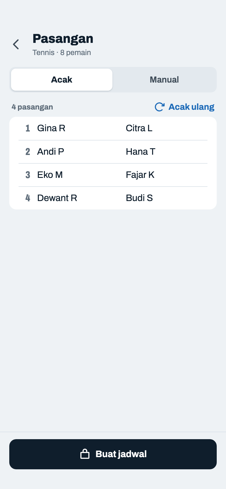
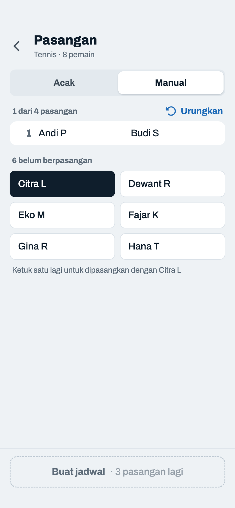
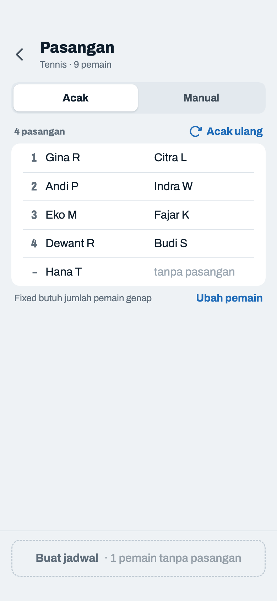
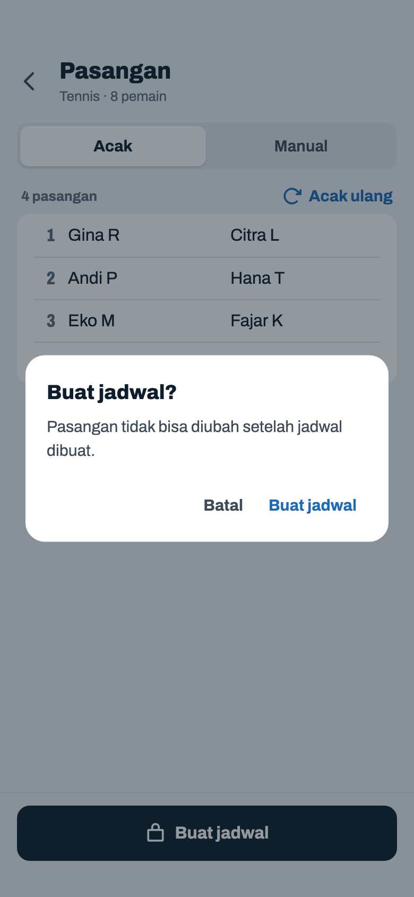
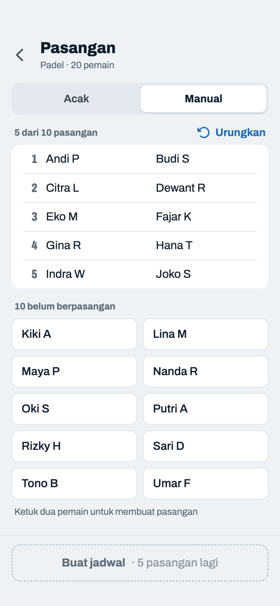

# Pasangan (Fixed)

> Dihasilkan `tool/hifi_extract.py` dari `design/hifi.html`. Jangan diedit langsung.

Hanya untuk mode Fixed. Satu daftar pasangan bernomor dengan dua kolom nama rata, bahasa visual yang sama dengan daftar di layar Pemain. Di Manual, pemain yang belum berpasangan ada di bawahnya sebagai chip dua kolom dan pindah ke daftar begitu dipasangkan. Pasangan diacak begitu layar dibuka; peringatan "tidak bisa diubah" ada di dialog saat menekan Buat jadwal.

## 04a · Acak

Komponen: `MabarAppBar`, `MabarButton`, `MabarTextButton`, `MabarIconButton`, `MabarActionBar`, `MabarGroup / MabarRow`, `MabarGroupHeader`, `MabarSegmented`, `PairList`

- Kartu 2×2 diganti daftar bernomor: satu baris per pasangan, nama rata dalam dua kolom, jadi 10 pasangan tetap rapi dan tidak ada kartu yang lebih tinggi dari sebelahnya.
- "Acak ulang" jadi tombol teks di ujung label daftar (`.ghead`), bukan tombol yang mengambang di tengah. Jumlah pasangan pindah dari subjudul ke label.
- Jumlah pasangan ganjil (mis. 3) tetap boleh: tiap round satu pasangan istirahat. Buat jadwal → dialog 04d.

## 04b · Manual · sedang memilih

Komponen: `MabarAppBar`, `MabarButton`, `MabarTextButton`, `MabarIconButton`, `MabarActionBar`, `MabarGroup / MabarRow`, `MabarGroupHeader`, `MabarSegmented`, `PairList`, `MabarChip`

- Dua bagian, urutan kerja dari atas: pasangan yang sudah jadi, lalu pemain yang belum berpasangan. Pemain yang sudah dipasangkan pindah ke daftar atas, tidak lagi tampil pudar di bawah, jadi tiap nama hanya ada di satu tempat.
- Chip dua kolom rata 44 pt (`.chips.cols`), bukan chip yang membungkus tidak rata. Slot kosong bergaris putus dihapus; progres ada di label "1 dari 4 pasangan".
- Ketuk A (gelap), lalu B → baris baru di daftar atas. Ketuk A lagi melepas pilihan. Catatan di bawah chip mengikuti keadaan: "Ketuk dua pemain…" atau "Ketuk satu lagi untuk dipasangkan dengan A".
- "Urungkan" melepas pasangan terakhir dan pilihan yang menggantung; mati kalau belum ada pasangan. Pindah ke Manual mengosongkan semua pasangan tanpa konfirmasi; kembali ke Acak membuang hasil manual.

## 04c · Jumlah pemain ganjil

Komponen: `MabarAppBar`, `MabarButton`, `MabarTextButton`, `MabarIconButton`, `MabarActionBar`, `MabarGroup / MabarRow`, `MabarGroupHeader`, `MabarSegmented`, `PairList`

- Pemain sisa jadi baris terakhir daftar dengan nomor "–" dan keterangan pudar, bukan kotak terpisah. Satu catatan di bawahnya dengan "Ubah pemain" → kembali ke layar Pemain dengan daftar tetap terisi.
- Di Manual, pemain terakhir yang tidak punya lawan pasangan berakhir di baris yang sama begitu chip-nya tinggal satu.

## 04d · Dialog · buat jadwal

Komponen: `MabarAppBar`, `MabarButton`, `MabarTextButton`, `MabarIconButton`, `MabarActionBar`, `MabarGroup / MabarRow`, `MabarGroupHeader`, `MabarSegmented`, `PairList`, `showMabarSheet`, `showMabarConfirm`

- Menggantikan kotak merah permanen "Pasangan tidak bisa diubah setelah jadwal dibuat". Memakai `showMabarConfirm` varian lanjut.
- Konfirmasi → Jadwal Fixed (round-robin penuh dibuat sekaligus).

## 04e · Manual · 20 pemain (terpadat)

Komponen: `MabarAppBar`, `MabarButton`, `MabarTextButton`, `MabarIconButton`, `MabarActionBar`, `MabarGroup / MabarRow`, `MabarGroupHeader`, `MabarSegmented`, `PairList`, `MabarChip`

- Kondisi terpadat Manual: 20 pemain, setengah jalan (5 pasangan + 10 chip). Tetap muat satu layar tanpa scroll karena baris pasangan 40 pt (sama dengan daftar di layar Pemain, tidak bisa diketuk) dan chip 44 pt; di titik lain jumlah baris + chip selalu lebih sedikit.
- Nama panjang dipotong elipsis di kolomnya, sama seperti daftar di layar Pemain.
