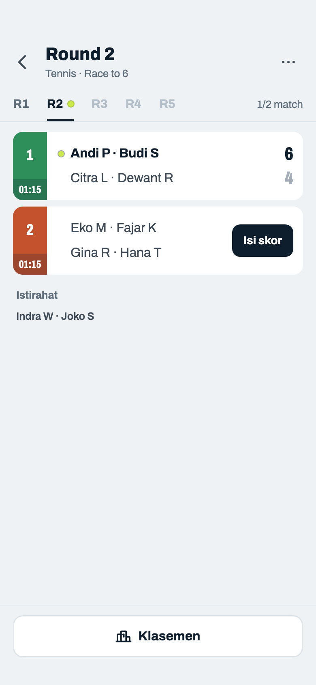
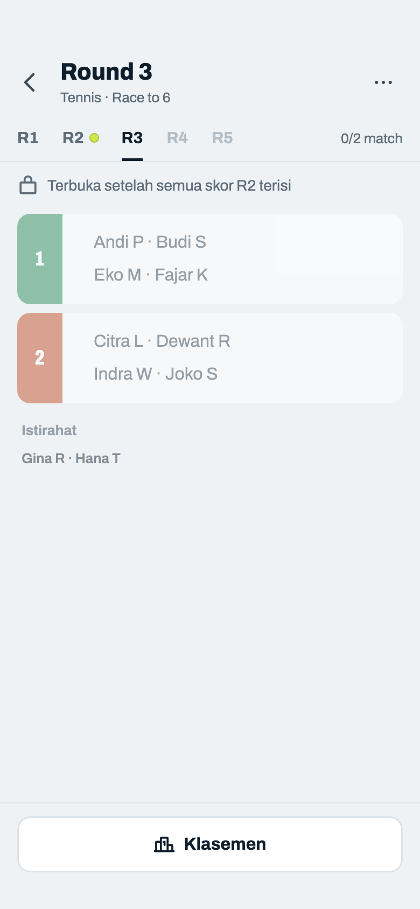
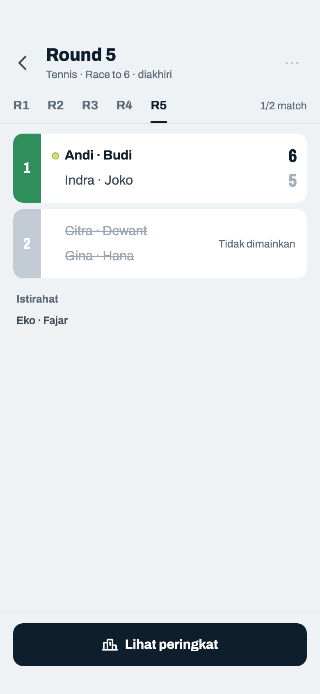
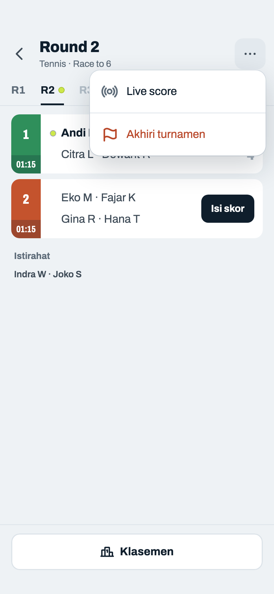
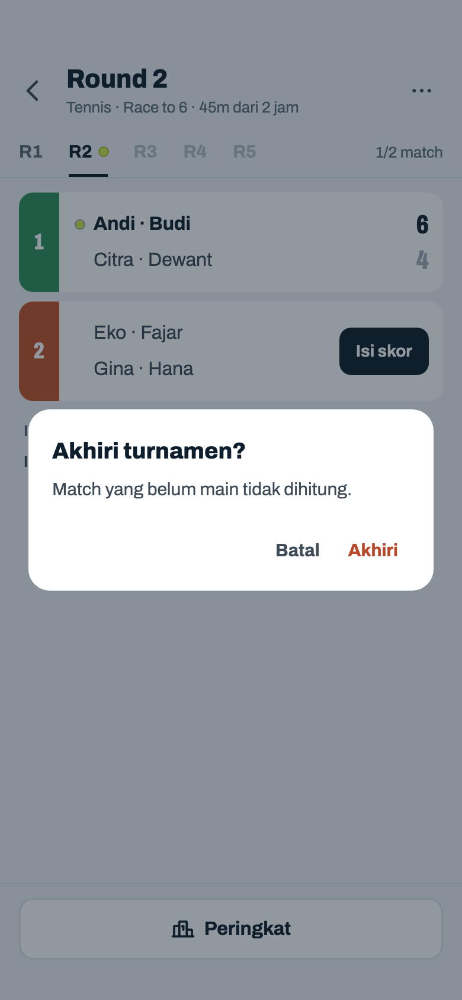

# Jadwal Fixed

> Dihasilkan `tool/hifi_extract.py` dari `design/hifi.html`. Jangan diedit langsung.

Round-robin penuh dibuat sekaligus. Contoh: Tennis, 10 pemain (5 pasangan), 2 court, jadi tiap round satu pasangan istirahat. Tombol akhiri yang dulu berupa lingkaran merah tanpa label pindah ke menu ⋯.

## 06a · Round berjalan

Komponen: `MabarAppBar`, `MabarButton`, `MabarIconButton`, `MabarActionBar`, `MabarGroup / MabarRow`, `MabarGroupHeader`, `RoundTabs`, `MatchScoreRow`, `RestingList`

- Judul = round yang dibuka. Subjudul: olahraga · mode · waktu berjalan dari jam mulai dibanding booking court terpanjang (format "1j 5m", diperbarui tiap menit). Emoji ⏱ dihapus.
- Tab default = round pertama yang masih ada match kosong. Pilihan tab bertahan; tidak pindah otomatis saat round selesai.
- Progress bar dihapus; "1/2 match" di ujung tab menggantikannya.
- Baris "Istirahat" hanya muncul kalau jumlah pasangan ganjil: paling banyak satu pasangan bye per round (`byePairIdByRound`), nama depan dipisah titik tengah.
- Ketuk baris yang sudah terisi → Input Skor dalam mode ubah (07i). Round sebelumnya tetap bisa diubah.

## 06b · Membuka round yang belum terbuka

Komponen: `MabarAppBar`, `MabarButton`, `MabarIconButton`, `MabarActionBar`, `MabarGroup / MabarRow`, `MabarGroupHeader`, `RoundTabs`, `MatchScoreRow`, `RestingList`

- Semua tab bisa dibuka untuk melihat lawan berikutnya, tapi baris di round yang terkunci tidak bisa diketuk dan tidak punya tombol "Isi skor".
- Kotak info "Round belum bisa dimulai" diganti satu baris dengan ikon gembok.

## 06c · Turnamen diakhiri

Komponen: `MabarAppBar`, `MabarButton`, `MabarIconButton`, `MabarActionBar`, `MabarGroup / MabarRow`, `MabarGroupHeader`, `RoundTabs`, `MatchScoreRow`, `RestingList`

- Setelah "Akhiri": match kosong jadi "Tidak dimainkan" (tidak bisa diketuk), tidak ada lagi titik live, dan tombol Peringkat jadi tombol utama. Sama untuk turnamen yang semua match-nya selesai.
- Fixed tidak bisa dilanjutkan, jadi tidak ada "Lanjutkan turnamen".
- Ikon ⋯ tampil pudar dan tidak bisa diketuk: satu-satunya item menu Fixed ("Akhiri turnamen") sudah tidak ada (keputusan host 2026-10-22).

## 06d · Menu ⋯ · Fixed

Komponen: `MabarAppBar`, `MabarButton`, `MabarIconButton`, `MabarActionBar`, `MabarGroup / MabarRow`, `MabarGroupHeader`, `RoundTabs`, `MatchScoreRow`, `RestingList`, `MabarMenu`

- Ikon ⋯ sekarang berfungsi (dulu cuma hiasan). Di Fixed isinya satu: "Akhiri turnamen" → dialog 06e.
- Setelah diakhiri, item ini tidak tampil lagi.

## 06e · Dialog · akhiri turnamen

Komponen: `MabarAppBar`, `MabarButton`, `MabarTextButton`, `MabarIconButton`, `MabarActionBar`, `MabarGroup / MabarRow`, `MabarGroupHeader`, `RoundTabs`, `MatchScoreRow`, `RestingList`, `showMabarSheet`, `showMabarConfirm`

- Dipakai Fixed dan Mixed. "Akhiri" mengubah semua match kosong jadi tidak dimainkan, menandai turnamen selesai, lalu membuka Peringkat.
