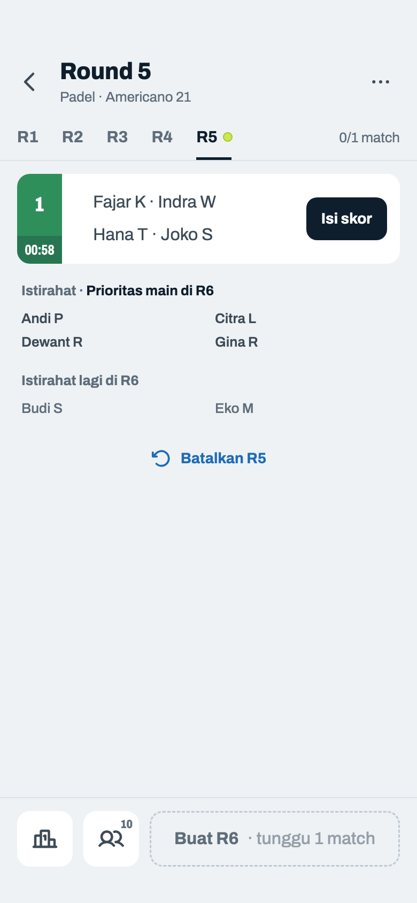
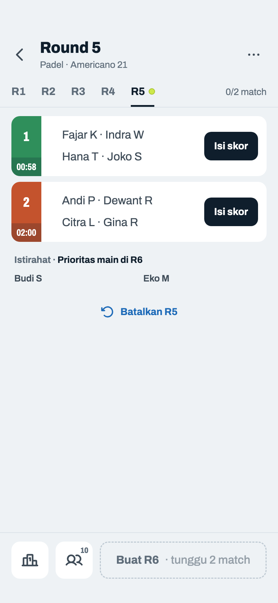
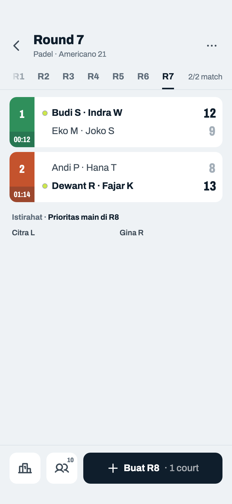
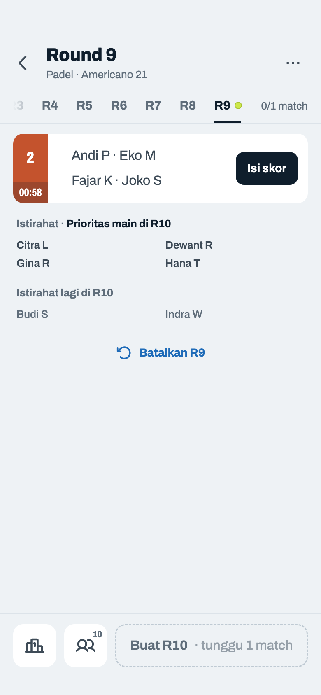
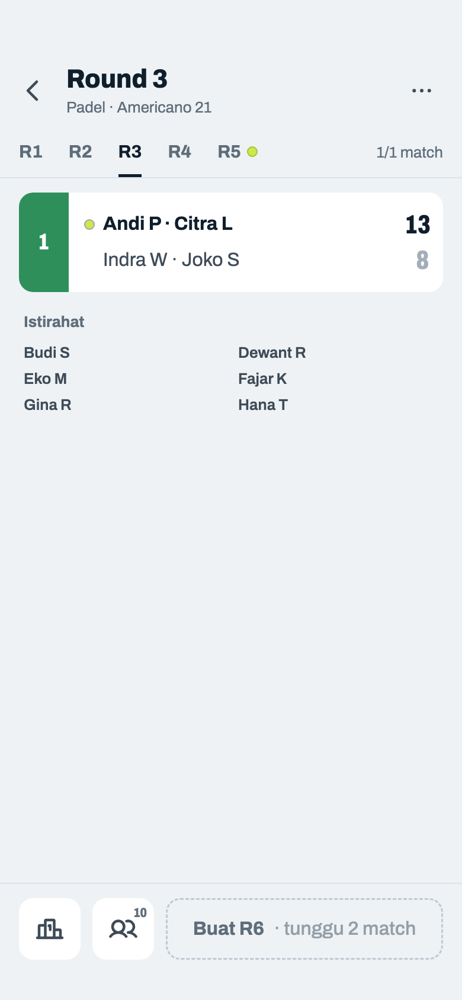
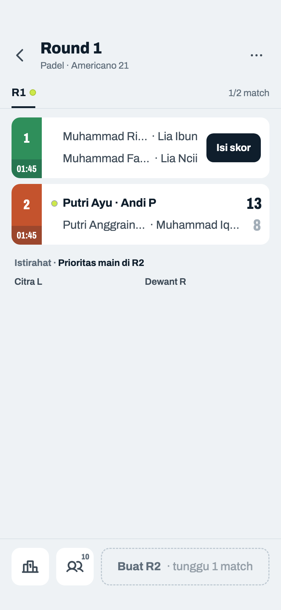

# Jadwal Mixed

> Dihasilkan `tool/hifi_extract.py` dari `design/hifi.html`. Jangan diedit langsung.

Round dibuat satu per satu. Contoh: Padel, Americano 21, 10 pemain, 2 court, jadi tiap round dua orang istirahat. Court bisa ditambah di tengah turnamen (06p–06t, sheet 08e–08k); sisa booking tiap court ada di kotak jam strip-nya. Kotak kuning "R… dibuat setelah skor R… lengkap" dihapus; alasannya ada di tombol.

## 06f · Round berjalan

Komponen: `MabarAppBar`, `MabarButton`, `MabarIconButton`, `MabarActionBar`, `MabarGroup / MabarRow`, `MabarGroupHeader`, `RoundTabs`, `MatchScoreRow`, `RestingList`

- Tab default = round terakhir; kembali ke round terakhir setelah Buat/Batalkan. Titik bola di round terakhir selama belum lengkap. Placeholder "R4 ?" dihapus.
- Badge LIVE dihapus. Istirahat: label lalu nama lengkap dalam dua kolom rata (banyak nama: 06o); judulnya "Istirahat · Prioritas main di R4" (bagian prioritas bertinta gelap, bukan biru court supaya tidak terbaca sebagai tautan), hanya saat melihat round terakhir. Nama seukuran judul (13). Kalau tidak semua kebagian slot R4, daftar dibagi dua (06o).
- Round terakhir: daftar dihitung dari pemain aktif sekarang (yang keluar tidak tampil, yang baru ditambahkan langsung masuk). Round yang sudah lewat: catatan saat round itu dibuat (06n).
- Action bar: Klasemen (ikon), Pemain (ikon + jumlah aktif → sheet 08a), Buat R4. Tombol akhiri pindah ke menu ⋯.

## 06g · Round lengkap · siap buat berikutnya

Komponen: `MabarAppBar`, `MabarButton`, `MabarIconButton`, `MabarActionBar`, `MabarGroup / MabarRow`, `MabarGroupHeader`, `RoundTabs`, `MatchScoreRow`, `RestingList`

- Aktif kalau round terakhir lengkap (selesai atau WO) dan masih ada court yang sisa booking-nya muat satu match. Sisa booking dihitung dari jam sungguhan sejak turnamen dimulai, bukan dari jumlah round × durasi: round yang selesai lebih cepat menyisakan waktu untuk round tambahan, dan "Waktu habis" baru muncul saat jamnya memang habis. Kalau court berkurang dibanding round terakhir: "Buat R4 · 1 court" (menggantikan "Sisa waktu booking: 1 dari 2 court").
- WO: pasangan yang kalah ditandai "WO" plus alasannya kalau diisi. Baru: alasan WO sekarang tampil (dulu disimpan tapi tidak pernah terlihat).
- Kalimat "Pemain yang istirahat diprioritaskan…" dihapus; baris Istirahat sudah menyatakannya.

## 06h · Round baru · masih bisa dibatalkan

Komponen: `MabarAppBar`, `MabarButton`, `MabarIconButton`, `MabarActionBar`, `MabarGroup / MabarRow`, `MabarGroupHeader`, `RoundTabs`, `MatchScoreRow`, `RestingList`

- "Batalkan R4" tampil kalau R4 belum ada skor sama sekali, turnamen belum diakhiri, dan bukan R1 (R1 tidak bisa dibatalkan). Hanya di tab round terakhir, dan hanya di sini (tidak di menu ⋯). Di tab lain tombol ini bisa terbaca membatalkan round yang sedang dilihat.
- Dipakai saat ada pemain baru datang: batalkan, tambah lewat Kelola pemain, lalu Buat R4 lagi. Tidak dibuat ulang otomatis.
- Semua label round di layar ini dinamis dari n = `roundCount`: "Batalkan R*n*", "Buat R*n+1*", "Prioritas main di R*n+1*". Daftar lengkapnya di tabel Label round (Fondasi).

## 06i · Menu ⋯ · Mixed

Komponen: `MabarAppBar`, `MabarButton`, `MabarIconButton`, `MabarActionBar`, `MabarGroup / MabarRow`, `MabarGroupHeader`, `RoundTabs`, `MatchScoreRow`, `RestingList`, `MabarMenu`

- Isi menu Mixed: "Live score" → dialog 12b / sheet 12c, "Kelola court" → sheet 08e, "Cara kerja Mixed" → sheet 06k, dan "Akhiri turnamen" → dialog 06e.
- "Kelola court" di menu, bukan di layar, supaya Jadwal tidak bertambah elemen. Namanya sejajar dengan Kelola pemain karena court juga diubah dan dihapus di sana. Ikon `square-split-horizontal` (lapangan dengan net). Ada selama turnamen belum diakhiri, termasuk saat court sudah 10 (sheet-nya lalu hanya berisi daftar).
- "Batalkan Rn" sengaja tidak ada di menu: syaratnya sama persis dengan tombol di layar (06h), jadi item menu tidak pernah menolong saat tombolnya tidak ada. Satu aksi, satu tempat.

## 06j · Dialog · batalkan round

Komponen: `MabarAppBar`, `MabarButton`, `MabarTextButton`, `MabarIconButton`, `MabarActionBar`, `MabarGroup / MabarRow`, `MabarGroupHeader`, `RoundTabs`, `MatchScoreRow`, `RestingList`, `showMabarSheet`, `showMabarConfirm`

- Setelah dibatalkan, layar pindah ke R3. Kredit pemain yang tidak ada di R4 dihitung ulang dari riwayat tanpa R4.
- Judul, isi ("tekan Buat R*n* lagi"), dan tombol memakai n yang sama: setelah dibatalkan, tombol bawah memang kembali jadi "Buat R*n*".

## 06k · Sheet · cara kerja Mixed

Komponen: `MabarAppBar`, `MabarButton`, `MabarIconButton`, `MabarActionBar`, `MabarGroup / MabarRow`, `MabarGroupHeader`, `RoundTabs`, `MatchScoreRow`, `RestingList`, `showMabarSheet`

- Pengganti layar 05 "Cara Kerja Mixed". Teks Aturan Fairness dan label Estimasi tetap sesuai permintaan host.
- Baru: muncul otomatis sekali saat R1 pertama kali dibuat, setelah itu lewat menu ⋯.
- Rumus tetap: Max Round = booking terpendek ÷ durasi; Match/Pemain = ⌊total match × 4 ÷ pemain⌋; Total Match = Max Round × court.

## 06l · Waktu booking habis

Komponen: `MabarAppBar`, `MabarButton`, `MabarIconButton`, `MabarActionBar`, `MabarGroup / MabarRow`, `MabarGroupHeader`, `RoundTabs`, `MatchScoreRow`, `RestingList`

- `canResume` tanpa "Akhiri": semua court sudah tidak muat round berikutnya. "Buat R9" diganti "Tambah jam" → sheet 08c. Kotak jam di strip berhenti di "00:00".
- Court baru dari Kelola court (08f) atau jam tambahan lewat detail court (08j) juga mengembalikan "Buat R9".
- Begitu round terakhir di sini lengkap, Klasemen dan Bagikan menyebutnya Final / "Klasemen akhir" (09f), tanpa perlu Akhiri.
- Baru: tab menulis "Waktu habis" (clay). Kotak kuning lama yang tetap menulis "0 dari 2 court" tidak muncul lagi.
- 8 tab tidak muat: baris tab digeser sampai round terakhir rapat di kanan, dan tab yang terpotong di kiri dipudarkan sebagai tanda masih ada round sebelumnya. Interaksi lengkapnya di 06n.

## 06m · Diakhiri · bisa dilanjutkan

Komponen: `MabarAppBar`, `MabarButton`, `MabarIconButton`, `MabarActionBar`, `MabarGroup / MabarRow`, `MabarGroupHeader`, `RoundTabs`, `MatchScoreRow`, `RestingList`

- Mixed yang sudah diakhiri bisa dilanjutkan: "Lanjutkan turnamen" → sheet 08c. Match "Tidak dimainkan" kembali bisa diisi setelah dilanjutkan.
- Tombol Pemain disembunyikan setelah diakhiri. Menu ⋯ hanya berisi "Cara kerja Mixed": Kelola court juga hilang, jam ditambah lewat Lanjutkan. Strip tanpa kotak jam.
- Kalimat "Turnamen sudah diakhiri · tambah jam court untuk main lagi" diringkas ke subjudul "diakhiri".

## 06n · Banyak round · melihat round awal

Komponen: `MabarAppBar`, `MabarButton`, `MabarIconButton`, `MabarActionBar`, `MabarGroup / MabarRow`, `MabarGroupHeader`, `RoundTabs`, `MatchScoreRow`, `RestingList`

- Tab muat ±6 dengan label kanan. Mixed bisa lebih dari 20 round (booking panjang, durasi pendek), Fixed sampai 105 round (15 pasangan, 1 court), jadi baris tab harus bisa digeser.
- Hanya baris tab yang digeser horizontal dengan jari; label kanan ("2/2 match", "Waktu habis") tetap di tempat. Kalau semua tab muat, tidak ada fade dan baris tidak bisa digeser.
- Tepi yang menyembunyikan tab dipudarkan 36 pt: kiri (06l), kanan (frame ini), atau keduanya saat di tengah. Tab yang terpotong di tepi adalah tanda utama bahwa masih ada round di baliknya.
- Saat layar dibuka, setelah Buat R*n*, dan setelah Batalkan R*n*, tab terpilih otomatis digeser masuk tampilan (round terakhir rapat kanan). Mengetuk tab yang terpotong menggesernya sampai utuh.
- Ganti round hanya lewat tab; daftar match tidak bisa digeser kiri-kanan, supaya geser tak sengaja saat mengisi skor tidak memindahkan round.
- Round yang sudah lewat menampilkan siapa yang benar-benar istirahat di round itu: catatan saat round dibuat (`restingPlayerIdsByRound`), tidak berubah oleh tambah atau keluar pemain sesudahnya. Pemain yang kemudian keluar tetap tampil tanpa penanda, sama seperti di Klasemen.
- Di round lewat tidak ada "Prioritas main di R…", daftar kedua, maupun "Batalkan R…"; semuanya hanya untuk round terakhir. Tombol bawah tetap untuk round berikutnya (Buat R13).
- Flutter: komponen `RoundTabs` (baris tab yang digeser + `ShaderMask` di tepi); tidak pakai `TabBarView`.

## 06o · Banyak yang istirahat · 30 pemain, 2 court

Komponen: `MabarAppBar`, `MabarButton`, `MabarIconButton`, `MabarActionBar`, `MabarGroup / MabarRow`, `MabarGroupHeader`, `RoundTabs`, `MatchScoreRow`, `RestingList`

- Kondisi terpadat Mixed: 30 pemain aktif. Dengan 2 court, 22 istirahat (11 baris); dengan 1 court 26 istirahat (13 baris) tapi hanya 1 match. Makin banyak court, makin sedikit yang istirahat. Kalau isinya lebih panjang dari layar, daftar di-scroll; app bar, tab, dan action bar tetap.
- Nama dalam dua kolom rata, urut seperti daftar pemain, terpotong elipsis kalau panjang; sama dengan daftar di layar Pemain dan Pasangan, bukan kalimat yang membungkus tidak rata.
- Yang istirahat lebih banyak dari slot round berikutnya (22 orang, R4 hanya 8 slot = 4 × court), jadi daftarnya dibagi dua: yang pasti main di R4 di bawah judul "Istirahat · Prioritas main di R4" (bagian prioritas bertinta gelap, bukan biru court supaya tidak terbaca sebagai tautan), dan sisanya di daftar kedua "Istirahat lagi di R4" yang lebih pudar. Kalau semua yang istirahat kebagian slot, hanya daftar pertama yang tampil (06f–06h).
- Isi kedua daftar dihitung dengan urutan yang sama persis dengan generator: jumlah main (termasuk kredit), lalu yang paling lama istirahat. Pemain yang seri diundi dengan undian yang dikunci per round (seed turnamen + nomor round), bukan diacak saat "Buat R4" ditekan. Jadi hasil Buat R4 selalu sama dengan daftar ini.
- Daftar dihitung ulang langsung kalau host menambah/mengeluarkan pemain (sheet 08a) atau jumlah court yang masih punya waktu berubah. Pemain yang baru ditambahkan langsung masuk salah satu daftar; yang keluar hilang dari keduanya.

## 06p · Mulai dengan 1 court

Komponen: `MabarAppBar`, `MabarButton`, `MabarIconButton`, `MabarActionBar`, `MabarGroup / MabarRow`, `MabarGroupHeader`, `RoundTabs`, `MatchScoreRow`, `RestingList`

- Contoh: mabar mulai 19.00 dengan Court 1 saja (booking 2 jam, sampai 21.00). 10 pemain: tiap round 4 main, 6 istirahat. Sekarang 20.02.
- Subjudul tidak lagi menulis waktu ("53m dari 2 jam"): court bisa mulai di jam berbeda, jadi waktunya ditulis di strip court masing-masing.
- Hitung mundur = booking − menit sejak **court itu** mulai, format jam:menit ("02:00", "00:58"), diperbarui tiap menit, berhenti di "00:00". Titik dua = durasi; jam dinding tetap ditulis dengan titik ("20.02").
- Hanya di round yang sedang berjalan (Mixed: round terakhir; Fixed: round yang dibuka) selama turnamen belum diakhiri. Round lain: strip hanya nomor (06t).

## 06q · Court 2 langsung dipakai di R5

Komponen: `MabarAppBar`, `MabarButton`, `MabarIconButton`, `MabarActionBar`, `MabarGroup / MabarRow`, `MabarGroupHeader`, `RoundTabs`, `MatchScoreRow`, `RestingList`

- Hitung mundur di kotak jam tinta 22% di dasar strip (dipilih host 2026-10-22, B). Teks putih kecil langsung di warna court (A) gagal 4,5:1 di 4 dari 10 warna, termasuk hijau Court 1 (4,0); di atas kotak ≥ 5,0 di kesepuluh warna.
- Match baru masuk R5 sebagai match ke-2 di Court 2 ("0/2 match"). R6 baru bisa dibuat setelah kedua match selesai, jadi Court 1 menunggu sebentar di akhir round: konsekuensi "langsung dipakai".
- Istirahat dihitung ulang dengan 2 court (8 slot di R6). Batalkan R5 menghapus kedua match; Court 2 tetap ada.
- Nomor court = urutan court ditambahkan, tidak pernah bergeser.

## 06r · Court 1 hampir habis · R8 tinggal 1 court

Komponen: `MabarAppBar`, `MabarButton`, `MabarIconButton`, `MabarActionBar`, `MabarGroup / MabarRow`, `MabarGroupHeader`, `RoundTabs`, `MatchScoreRow`, `RestingList`

- Pukul 20.48: Court 1 "00:12", kurang dari durasi 15 mnt, jadi tidak ikut R8; tombolnya "Buat R8 · 1 court" (aturan 06g). Court 2 "01:14".
- Strip tidak diberi warna peringatan: warna court bisa mirip clay (Court 2 terracotta), dan tombol Buat sudah menyebut jumlah court-nya.

## 06s · Court 1 habis · lanjut di Court 2

Komponen: `MabarAppBar`, `MabarButton`, `MabarIconButton`, `MabarActionBar`, `MabarGroup / MabarRow`, `MabarGroupHeader`, `RoundTabs`, `MatchScoreRow`, `RestingList`

- Pukul 21.04, lanjutan 06r tanpa Court 3. Court 1 sudah habis dan tidak punya match di R9, jadi tidak tampil di layar; terlihat di Kelola court ("2 court · 1 habis", baris "19.00–21.00 · waktu habis").
- Strip tetap memakai nomor court-nya (2). Tanpa Court 2, sesi ini sudah berhenti jam 21.00 (06l).

## 06t · Round lewat · strip tanpa hitung mundur

Komponen: `MabarAppBar`, `MabarButton`, `MabarIconButton`, `MabarActionBar`, `MabarGroup / MabarRow`, `MabarGroupHeader`, `RoundTabs`, `MatchScoreRow`, `RestingList`

- Round yang sudah lewat hanya menulis nomor court: sisa waktu adalah keadaan sekarang, bukan milik R3. Lebar strip tetap 42 supaya pindah tab tidak menggeser nama.

## 06u · Nama lengkap panjang · nama depan sama

Komponen: `MabarAppBar`, `MabarButton`, `MabarIconButton`, `MabarActionBar`, `MabarGroup / MabarRow`, `MabarGroupHeader`, `RoundTabs`, `MatchScoreRow`, `RestingList`

- Nama di baris match ditulis lengkap, juga di Input Skor, sheet WO, riwayat Detail, Istirahat Fixed, dan caption: dua pemain bernama depan sama (Lia Ibun, Lia Ncii) tetap terbedakan.
- Tim tidak muat: tiap nama dipotong elipsis sendiri. Nama yang muat di separuh lebar tetap utuh dan nama lain mengisi sisanya (Court 1); dua-duanya lebih panjang → dibagi rata (Court 2 bawah). Memotong hanya ujung baris bisa menghilangkan nama kedua seluruhnya ("Muhammad Rizky Pratama · Li…").
- Selalu satu baris, jadi tinggi baris dan tombol Isi skor tidak bergeser.
