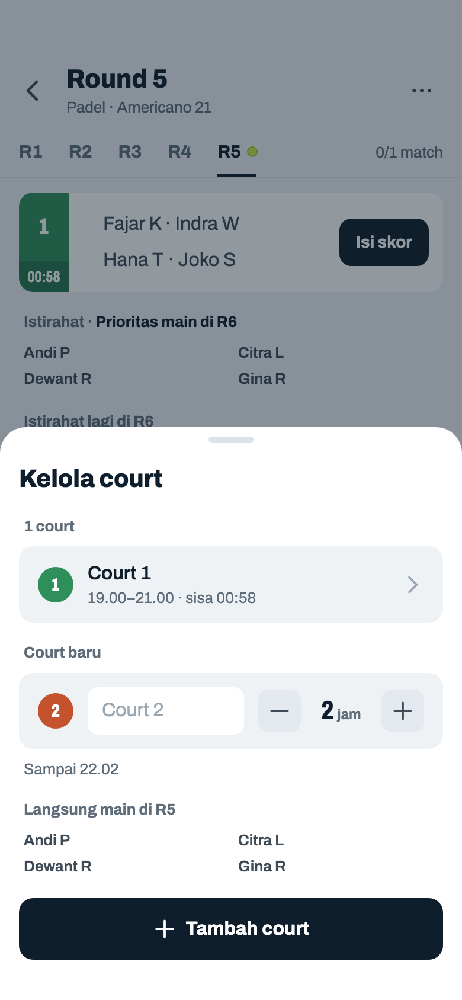
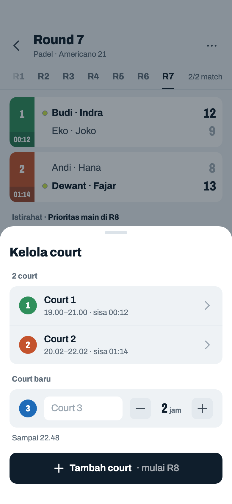
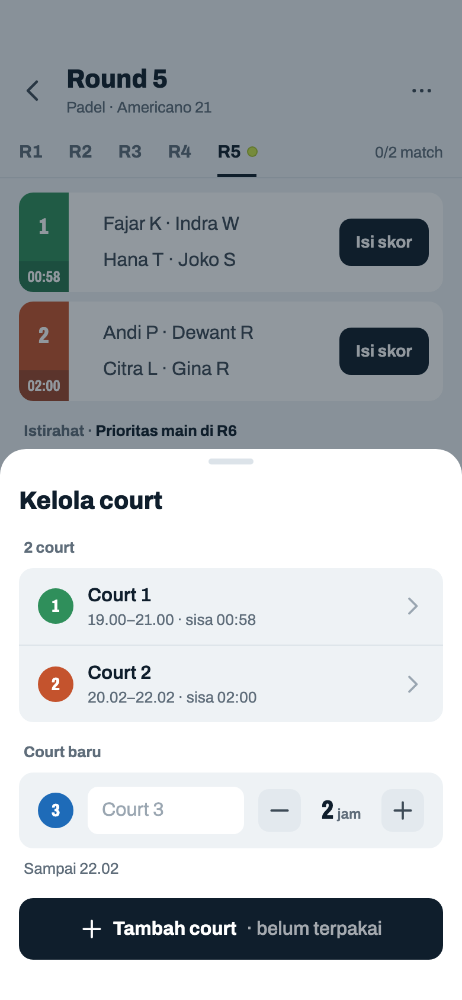
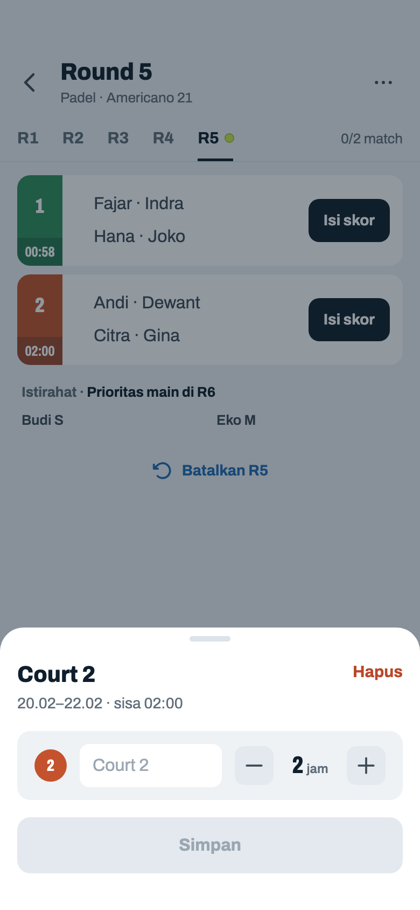
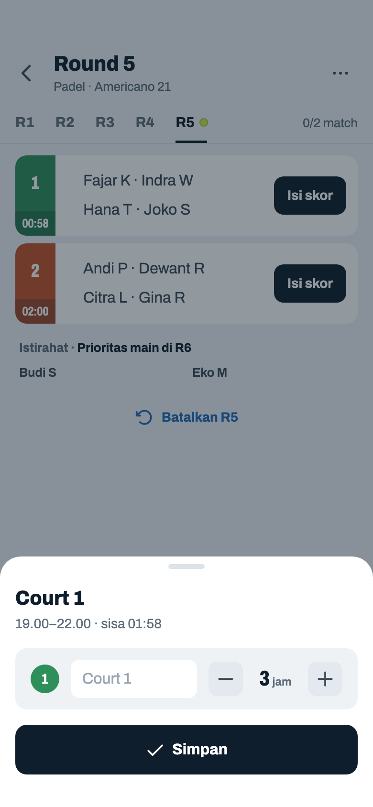
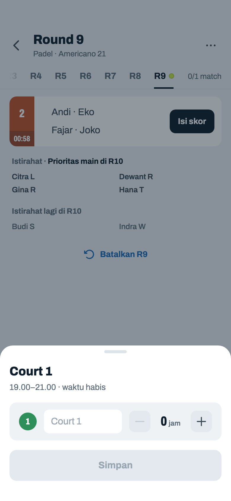
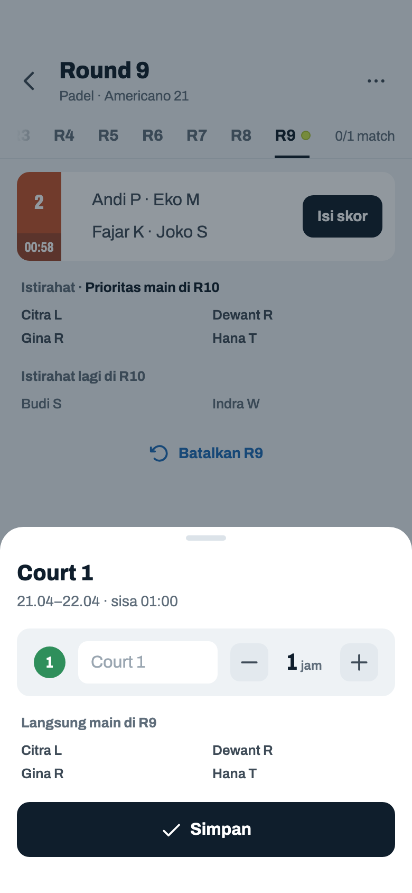

# Pemain, court, dan lanjutkan (Mixed)

> Dihasilkan `tool/hifi_extract.py` dari `design/hifi.html`. Jangan diedit langsung.

Sheet yang hanya ada di Mixed: mengubah daftar pemain dan court di tengah turnamen, dan menambah jam booking untuk melanjutkan turnamen. Contoh Kelola court: Padel, Americano 21, 15 mnt, 10 pemain; Court 1 19.00–21.00, Court 2 ditambah 20.02 saat R5 berjalan.

## 08a · Sheet · kelola pemain

Komponen: `MabarAppBar`, `MabarButton`, `MabarIconButton`, `MabarRowAction`, `MabarActionBar`, `MabarGroup / MabarRow`, `MabarGroupHeader`, `MabarField`, `RoundTabs`, `MatchScoreRow`, `RestingList`, `showMabarSheet`

- Dibuka dari tombol Pemain di action bar. Sheet naik bersama keyboard; daftar scroll di dalam.
- Jumlah ditulis sekali, di label daftar: aktif · keluar. Dulu subjudul menulis "10 pemain aktif" dan label "Peserta (11)": dua istilah dan dua angka untuk daftar yang sama.
- Nama dibersihkan seperti di layar Pemain (nomor/bullet dibuang), cocok-tidaknya tidak peka huruf besar. Enter = Tambah.
- Tombol Tambah 48 pt, sama tinggi dengan kolom nama di sebelahnya.
- "Keluarkan" dan "Kembalikan" memakai `.rowact`. Keluarkan sengaja netral, bukan merah: bisa dibatalkan lewat Kembalikan, dan merah di setiap baris membuat daftar ramai.
- "Keluarkan" langsung tanpa konfirmasi; pemain tidak dihapus, hanya keluar dari round berikutnya. Match yang sudah terjadwal tetap ada (bisa ditandai WO).
- Pemain baru/kembali (absen di round sebelumnya) diprioritaskan sampai jumlah match-nya menyusul yang paling banyak main, tapi istirahat 1 round setelah main k round beruntun: k = 2, atau satu lebih dari ritme pemain lain kalau 2 belum cukup untuk menyusul (12 pemain / 2 court: pemain lain main 2 dari 3 round → k = 3). Prioritas jadwal saja, tidak ikut ranking. Kalau semua pemain main tiap round (12 pemain / 3 court), selisihnya memang tidak bisa dikejar.

## 08b · Kelola · nama sudah ada · batas minimum

Komponen: `MabarAppBar`, `MabarButton`, `MabarIconButton`, `MabarRowAction`, `MabarActionBar`, `MabarGroup / MabarRow`, `MabarField`, `RoundTabs`, `MatchScoreRow`, `showMabarSheet`

- Pesan error lain: "Nama tidak boleh kosong" · "Eko M sudah ada — pakai "Kembalikan" di bawah" (nama pemain yang keluar) · "Maksimal 30 pemain aktif" (saat Tambah atau Kembalikan).
- Aktif ≤ 4: semua "Keluarkan" mati.

## 08c · Sheet · lanjutkan turnamen

Komponen: `MabarAppBar`, `MabarButton`, `MabarIconButton`, `MabarActionBar`, `MabarGroup / MabarRow`, `MabarGroupHeader`, `MabarStepper`, `RoundTabs`, `MatchScoreRow`, `RestingList`, `showMabarSheet`, `CourtColorPicker`

- Dibuka dari 06l, 06m, atau Beranda 01a / 01c. Tambahan jam per court 0–6, dihitung dari sekarang kalau booking-nya sudah lewat: `max(booking, menit berjalan) + tambahan`.
- Keterangan per court: "Waktu habis", atau "Sisa 00:45" kalau booking-nya belum lewat (turnamen diakhiri lebih awal, 06m, atau sisa kurang dari satu match). Setelah ditambah: "→ 01:00". Format sama dengan kotak jam di strip (jam:menit, 2026-10-22; dulu "45m", "→ 1j").
- Hitungan estimasi (sama dengan `capacityAhead`), n = round terakhir: ① sisa tiap court = max(0, booking − menit berjalan sejak turnamen dimulai) ② round tiap court k = ⌊(sisa + tambahan) ÷ durasi⌋ ③ jumlah round = k terbesar; court di round ke-r = jumlah court dengan k ≥ r ④ match = Σ min(court di round r, ⌊pemain aktif ÷ 4⌋) → angka besar.
- Contoh frame ini: durasi 15 mnt, n = 8, booking 2 jam, sudah berjalan 2j 4m. Court 1: sisa 0 + 1 jam = 60 mnt → k = 4. Court VIP: sisa 0 + 0 → k = 0. Jadi 4 round (R9–R12) dengan 1 court; 10 pemain aktif = maks 2 match per round; 4 × min(1, 2) = **4 match**.
- Kalimat di bawah angka: "4 round (R9–R12)" (satu round: "1 round (R9)") · "1 court" kalau jumlah court sama di semua round, atau "2 court, berkurang mulai R11" kalau ada court yang habis lebih dulu · "maks 1 match per round (6 pemain)" kalau pemain yang membatasi. Baris terpisah kalau ada: "2 match yang belum dimainkan bisa diisi lagi".
- Beda dengan kode sekarang: kode menulis "mulai R… court berkurang" setiap kali ada court yang tidak ikut sampai akhir, termasuk court yang sudah habis sejak awal (di frame ini akan tertulis "mulai R9 court berkurang"). Yang dihitung "berkurang" hanya court yang masih main di R*n+1* lalu habis di tengah.
- Lanjutkan: match "Tidak dimainkan" kembali kosong, turnamen aktif lagi. Dari Beranda, app lalu membuka Jadwal.

## 08d · Lanjutkan · belum ada tambahan

Komponen: `MabarAppBar`, `MabarButton`, `MabarIconButton`, `MabarActionBar`, `MabarGroup / MabarRow`, `MabarGroupHeader`, `MabarStepper`, `RoundTabs`, `MatchScoreRow`, `RestingList`, `showMabarSheet`, `CourtColorPicker`

- Tombol mati selama estimasi 0 match dan tidak ada match "Tidak dimainkan".
- Kalau turnamen diakhiri sebelum waktunya habis, estimasi langsung > 0 tanpa menambah jam dan tombol aktif.

## 08e · Sheet · kelola court, langsung main

Komponen: `MabarAppBar`, `MabarButton`, `MabarIconButton`, `MabarActionBar`, `MabarGroup / MabarRow`, `MabarGroupHeader`, `MabarStepper`, `MabarField`, `RoundTabs`, `MatchScoreRow`, `RestingList`, `showMabarSheet`, `CourtColorPicker`

- Judul "Kelola court". Label daftar = jumlah court ("1 court", "2 court · 1 habis"), seperti "10 pemain aktif · 1 keluar" di Kelola pemain. Isinya semua court beserta jendela jam dan sisanya, termasuk yang habis atau belum terpakai; ketuk satu → detail court (08h–08k). Hanya di sini waktu court tanpa match terlihat.
- Beda urutan dengan Kelola pemain (tambah di atas): menambah court punya akibat langsung (match baru), jadi pakai tombol di bawah, dan daftar court ditaruh di atas supaya tombol menempel ke Court baru.
- Court baru = baris court Konfigurasi: warna (ketuk → 03e), nama (kosong = "Court n"), booking 1–12 jam, default warna berikutnya dan 2 jam. Jam dihitung dari saat ditambah; di bawahnya hanya fakta "Sampai 22.02", ikut stepper, supaya host bisa mencocokkan dengan booking-nya.
- Tanpa kalimat penjelas (Penulisan, Fondasi): kapan court dipakai ditulis di tombol, seperti "Buat R4 · tunggu 1 match". Di sini nama yang langsung main sudah tertulis, jadi tombolnya polos.
- Round berjalan dan yang istirahat minimal 4: court langsung dipakai di round itu (keputusan host). Satu match baru untuk 4 teratas urutan prioritas R6 (paling jarang main → paling lama istirahat → undian terkunci); di contoh ini persis 4 nama "Prioritas main di R6". Pasangannya disusun dengan penalti yang sama dengan Buat round.
- Selisih match antar pemain tetap ≤ 1, dan pemain yang sedang main tidak pernah diambil.
- Booking lebih pendek dari durasi match: angka clay, catatan error, tombol mati (seperti 03d). Varian: 08f round lengkap, 08g pemain tidak cukup.

## 08f · Kelola court · round lengkap

Komponen: `MabarAppBar`, `MabarButton`, `MabarIconButton`, `MabarActionBar`, `MabarGroup / MabarRow`, `MabarGroupHeader`, `MabarStepper`, `MabarField`, `RoundTabs`, `MatchScoreRow`, `RestingList`, `showMabarSheet`, `CourtColorPicker`

- Round terakhir sudah lengkap: tidak ada match baru, court ikut round berikutnya ("Tambah court · mulai R8"). Court 1 tidak ikut R8 karena sisanya kurang dari satu match; setelah ditambah, tombol Jadwal jadi "Buat R8" (2 court, sama dengan R7).
- Sama untuk Waktu habis (06l): court baru mengubah "Tambah jam" kembali jadi "Buat R9", Klasemen kembali Sementara.

## 08g · Kelola court · pemain tidak cukup

Komponen: `MabarAppBar`, `MabarButton`, `MabarIconButton`, `MabarActionBar`, `MabarGroup / MabarRow`, `MabarGroupHeader`, `MabarStepper`, `MabarField`, `RoundTabs`, `MatchScoreRow`, `RestingList`, `showMabarSheet`, `CourtColorPicker`

- Satu court butuh 4 pemain; 10 pemain hanya mengisi 2 court, jadi tombolnya "Tambah court · belum terpakai". Tetap boleh ditambah (pemain lain mungkin sedang di jalan); begitu pemain cukup, court ikut round berikutnya.
- Kalau pemain aktif cukup, yang istirahat selalu minimal 4, jadi sheet ini hanya punya tiga keadaan: langsung main (08e), mulai round berikutnya (08f), pemain tidak cukup (frame ini).

## 08h · Sheet · detail court, bisa dihapus

Komponen: `MabarAppBar`, `MabarButton`, `MabarTextButton`, `MabarIconButton`, `MabarActionBar`, `MabarGroup / MabarRow`, `MabarGroupHeader`, `MabarStepper`, `MabarField`, `RoundTabs`, `MatchScoreRow`, `RestingList`, `showMabarSheet`, `CourtColorPicker`

- Dibuka dengan mengetuk court di Kelola court (08e). Sheet jenis aksi (keputusan host 2026-10-22): nama, warna, dan jam hanya pratinjau sampai Simpan ditekan; Simpan mati selama belum ada yang diubah. Mengubah jam bisa membuat match baru (08k), jadi tidak boleh terjadi dari satu ketukan stepper.
- "Hapus" (aksi teks clay di kanan atas, seperti WO di Input Skor) hanya ada selama court belum punya skor atau WO dan bukan satu-satunya court. Ketuk → dialog "Hapus Court 2?" · "Match R5 di court ini ikut dihapus." · Batal / Hapus (bahaya); pemainnya kembali istirahat.
- Stepper = panjang booking court itu: + memperpanjang ujungnya, − memendekkan, minimal 1 jam. Kalau ujungnya jadi lewat dari sekarang, court habis dan tidak ikut round berikutnya; match yang sedang dimainkan tetap bisa diisi skornya.

## 08i · Detail court · sudah ada skor, jam ditambah

Komponen: `MabarAppBar`, `MabarButton`, `MabarIconButton`, `MabarActionBar`, `MabarGroup / MabarRow`, `MabarGroupHeader`, `MabarStepper`, `MabarField`, `RoundTabs`, `MatchScoreRow`, `RestingList`, `showMabarSheet`, `CourtColorPicker`

- Court yang sudah punya skor atau WO tidak bisa dihapus, jadi tidak ada aksi "Hapus" (tanpa kalimat alasan). Sama untuk court satu-satunya.
- Frame ini setelah + satu kali (2 → 3 jam): subjudul langsung menulis jendela baru "19.00–22.00 · sisa 01:58", tapi Jadwal di belakang belum berubah sampai Simpan ditekan.

## 08j · Detail court · sudah habis

Komponen: `MabarAppBar`, `MabarButton`, `MabarIconButton`, `MabarActionBar`, `MabarGroup / MabarRow`, `MabarGroupHeader`, `MabarStepper`, `MabarField`, `RoundTabs`, `MatchScoreRow`, `RestingList`, `showMabarSheet`, `CourtColorPicker`

- Pukul 21.04 (06s): booking Court 1 selesai 21.00. Stepper 0 jam (− mati), seperti baris court yang habis di Lanjutkan (08c).
- Tambahan untuk court yang sudah habis dihitung **dari sekarang**, bukan disambung dari 21.00, karena court-nya dipesan ulang mulai saat ini. Aturannya sama dengan Lanjutkan: `max(ujung booking, sekarang) + tambahan`.

## 08k · Court habis dipesan ulang · langsung main

Komponen: `MabarAppBar`, `MabarButton`, `MabarIconButton`, `MabarActionBar`, `MabarGroup / MabarRow`, `MabarGroupHeader`, `MabarStepper`, `MabarField`, `RoundTabs`, `MatchScoreRow`, `RestingList`, `showMabarSheet`, `CourtColorPicker`

- Setelah + satu kali: jendela baru 21.04–22.04. R9 sedang berjalan dan 6 orang istirahat, jadi court ini langsung dipakai seperti court baru di 08e: 4 teratas urutan prioritas (persis "Prioritas main di R10" di 06s) dan namanya tertulis sebelum Simpan ditekan.
- Simpan → match ke-2 R9 di Court 1 dengan strip "01:00"; Budi dan Indra tetap istirahat dan masuk Prioritas main di R10. Round sudah lengkap → tanpa daftar nama, court ikut round berikutnya.
- Skor match lama di Court 1 tetap; jendela 19.00–21.00 tidak perlu disimpan untuk jadwal.
