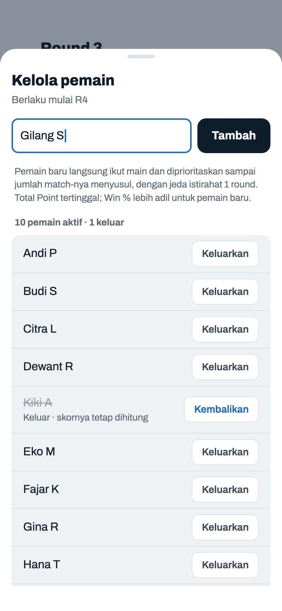
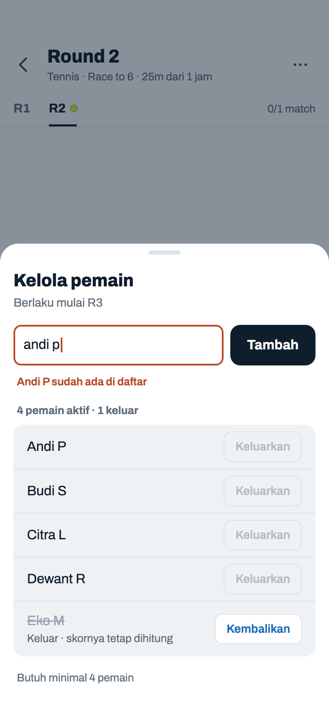
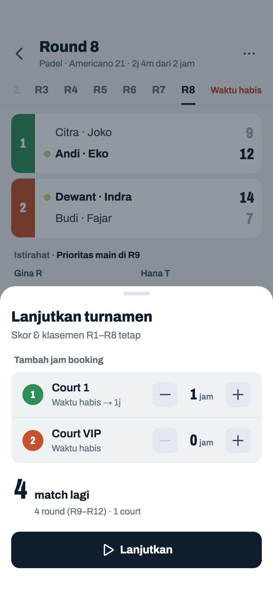
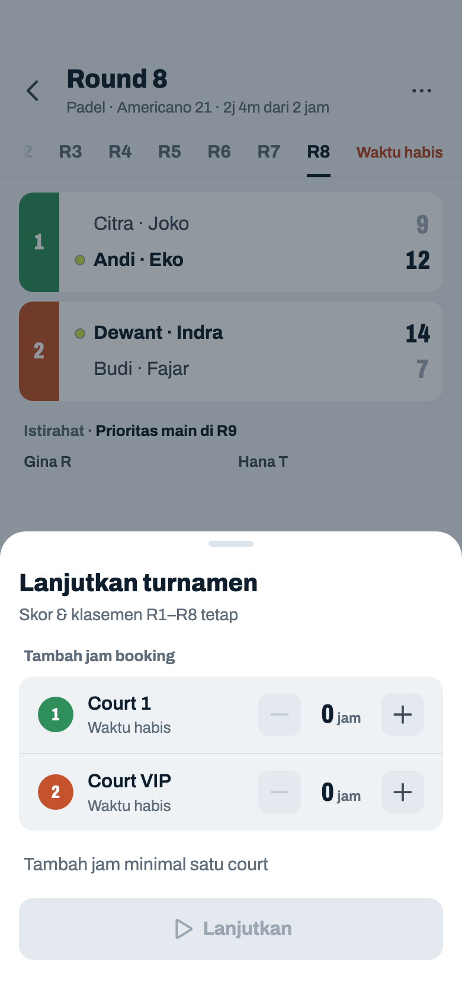

# Pemain dan lanjutkan (Mixed)

> Dihasilkan `tool/hifi_extract.py` dari `design/hifi.html`. Jangan diedit langsung.

Dua sheet yang hanya ada di Mixed: mengubah daftar pemain di tengah turnamen, dan menambah jam booking untuk melanjutkan turnamen.

## 08a · Sheet · kelola pemain

Komponen: `MabarAppBar`, `MabarButton`, `MabarIconButton`, `MabarRowAction`, `MabarActionBar`, `MabarGroup / MabarRow`, `MabarGroupHeader`, `MabarField`, `RoundTabs`, `MatchScoreRow`, `RestingList`, `showMabarSheet`

- Dibuka dari tombol Pemain di action bar. Sheet naik bersama keyboard; daftar scroll di dalam.
- Jumlah ditulis sekali, di label daftar: aktif · keluar. Dulu subjudul menulis "10 pemain aktif" dan label "Peserta (11)": dua istilah dan dua angka untuk daftar yang sama.
- Nama dibersihkan seperti di layar Pemain (nomor/bullet dibuang), cocok-tidaknya tidak peka huruf besar. Enter = Tambah.
- Tombol Tambah 48 pt, sama tinggi dengan kolom nama di sebelahnya.
- "Keluarkan" dan "Kembalikan" memakai `.rowact`. Keluarkan sengaja netral, bukan merah: bisa dibatalkan lewat Kembalikan, dan merah di setiap baris membuat daftar ramai.
- "Keluarkan" langsung tanpa konfirmasi; pemain tidak dihapus, hanya keluar dari round berikutnya. Match yang sudah terjadwal tetap ada (bisa ditandai WO).
- Pemain baru/kembali dapat kredit "catch-up" (prioritas jadwal saja, tidak ikut ranking).

## 08b · Kelola · nama sudah ada · batas minimum

Komponen: `MabarAppBar`, `MabarButton`, `MabarIconButton`, `MabarRowAction`, `MabarActionBar`, `MabarGroup / MabarRow`, `MabarField`, `RoundTabs`, `MatchScoreRow`, `showMabarSheet`

- Pesan error lain: "Nama tidak boleh kosong" · "Eko M sudah ada — pakai "Kembalikan" di bawah" (nama pemain yang keluar) · "Maksimal 20 pemain aktif" (saat Tambah atau Kembalikan).
- Aktif ≤ 4: semua "Keluarkan" mati.

## 08c · Sheet · lanjutkan turnamen

Komponen: `MabarAppBar`, `MabarButton`, `MabarIconButton`, `MabarActionBar`, `MabarGroup / MabarRow`, `MabarGroupHeader`, `MabarStepper`, `RoundTabs`, `MatchScoreRow`, `RestingList`, `showMabarSheet`, `CourtColorPicker`

- Dibuka dari 06l, 06m, atau Beranda 01a / 01c. Tambahan jam per court 0–6, dihitung dari sekarang kalau booking-nya sudah lewat: `max(booking, menit berjalan) + tambahan`.
- Keterangan per court: "Waktu habis", atau "Sisa 45m" kalau booking-nya belum lewat (turnamen diakhiri lebih awal, 06m, atau sisa kurang dari satu match). Setelah ditambah: "→ 1j". Format durasi "3j 20m", "1j", "45m".
- Hitungan estimasi (sama dengan `capacityAhead`), n = round terakhir: ① sisa tiap court = max(0, booking − menit berjalan sejak turnamen dimulai) ② round tiap court k = ⌊(sisa + tambahan) ÷ durasi⌋ ③ jumlah round = k terbesar; court di round ke-r = jumlah court dengan k ≥ r ④ match = Σ min(court di round r, ⌊pemain aktif ÷ 4⌋) → angka besar.
- Contoh frame ini: durasi 15 mnt, n = 8, booking 2 jam, sudah berjalan 2j 4m. Court 1: sisa 0 + 1 jam = 60 mnt → k = 4. Court VIP: sisa 0 + 0 → k = 0. Jadi 4 round (R9–R12) dengan 1 court; 10 pemain aktif = maks 2 match per round; 4 × min(1, 2) = **4 match**.
- Kalimat di bawah angka: "4 round (R9–R12)" (satu round: "1 round (R9)") · "1 court" kalau jumlah court sama di semua round, atau "2 court, berkurang mulai R11" kalau ada court yang habis lebih dulu · "maks 1 match per round (6 pemain)" kalau pemain yang membatasi. Baris terpisah kalau ada: "2 match yang belum dimainkan bisa diisi lagi".
- Beda dengan kode sekarang: kode menulis "mulai R… court berkurang" setiap kali ada court yang tidak ikut sampai akhir, termasuk court yang sudah habis sejak awal (di frame ini akan tertulis "mulai R9 court berkurang"). Yang dihitung "berkurang" hanya court yang masih main di R*n+1* lalu habis di tengah.
- Lanjutkan: match "Tidak dimainkan" kembali kosong, turnamen aktif lagi. Dari Beranda, app lalu membuka Jadwal.

## 08d · Lanjutkan · belum ada tambahan

Komponen: `MabarAppBar`, `MabarButton`, `MabarIconButton`, `MabarActionBar`, `MabarGroup / MabarRow`, `MabarGroupHeader`, `MabarStepper`, `RoundTabs`, `MatchScoreRow`, `RestingList`, `showMabarSheet`, `CourtColorPicker`

- Tombol mati selama estimasi 0 match dan tidak ada match "Tidak dimainkan".
- Kalau turnamen diakhiri sebelum waktunya habis, estimasi langsung > 0 tanpa menambah jam dan tombol aktif.
