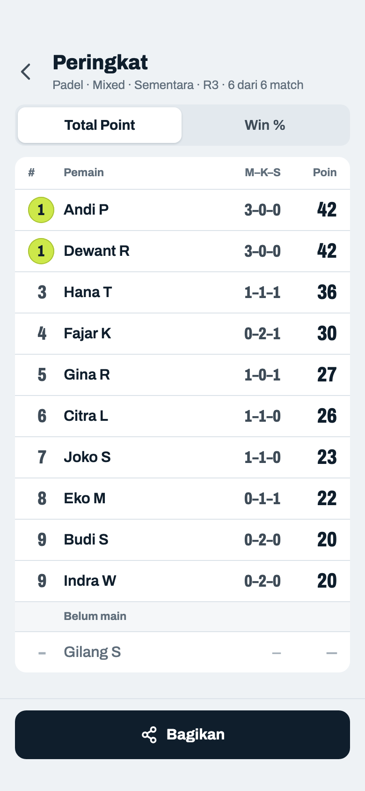
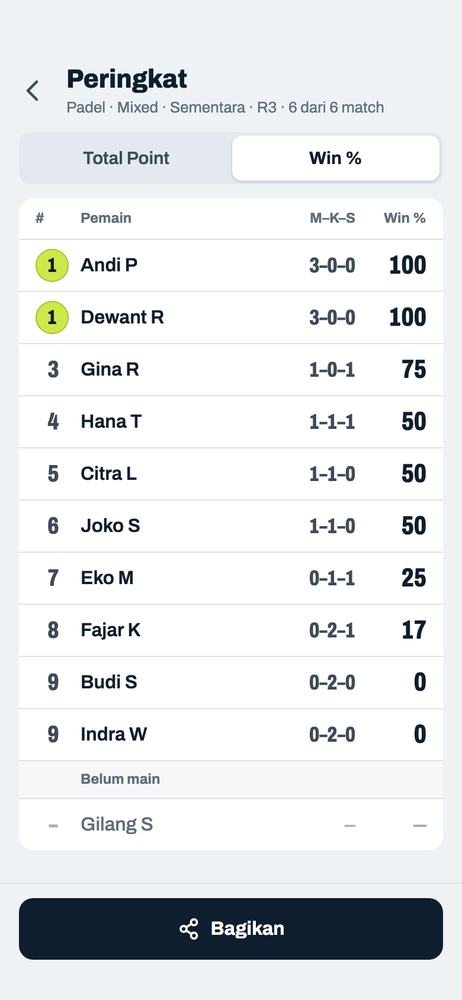
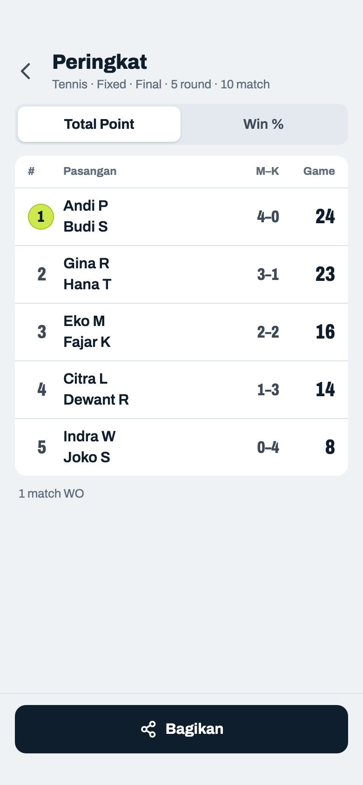
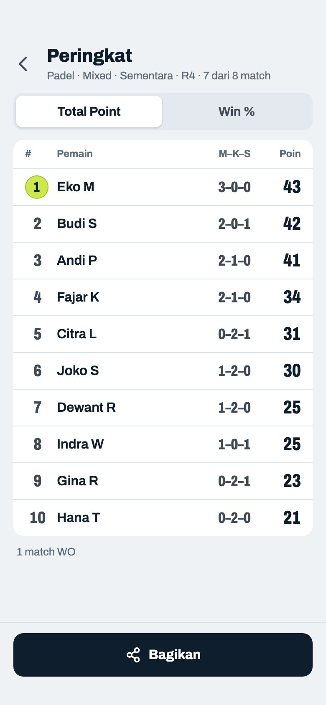
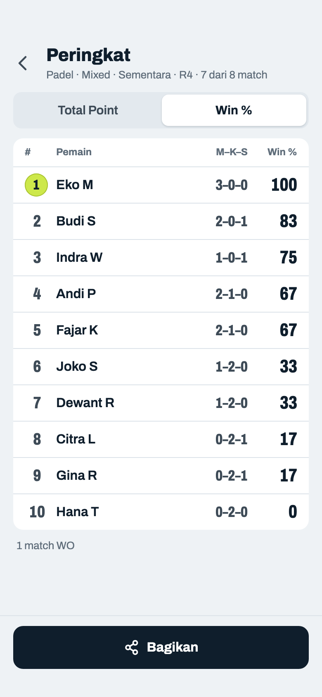
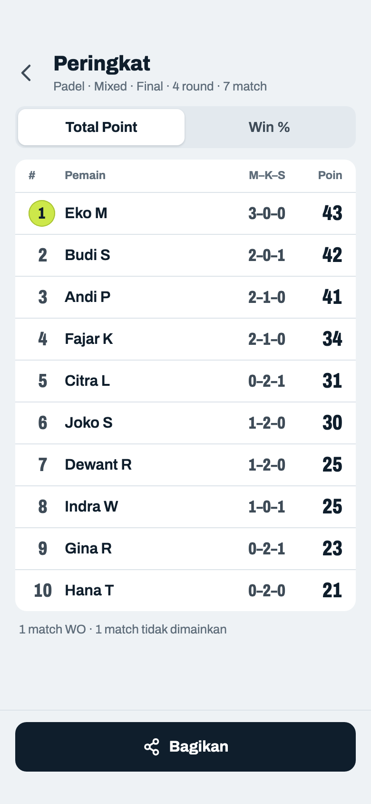

# Peringkat

> Dihasilkan `tool/hifi_extract.py` dari `design/hifi.html`. Jangan diedit langsung.

Tabel rapat dengan angka rata kanan. Status ditulis di subjudul, bukan badge. Metode yang dipilih di sini juga dipakai Detail dan Bagikan.

## 09a · Mixed · Total Point · statistik identik

Komponen: `MabarAppBar`, `MabarButton`, `MabarIconButton`, `MabarActionBar`, `MabarSegmented`, `StandingTable`

- Statistik identik → nomor sama (1, 1, 3 dan 9, 9). Urutan baris tetap mengikuti tie-break: metode → Total Point → head-to-head → selisih → nama.
- Kolom M–K–S = menang–kalah–seri. Seri tidak lagi ditulis kecil di bawah nama, jadi tinggi semua baris sama. Kolom S hanya ada kalau format skornya bisa seri (Americano total genap, Best of genap); Race to dan format ganjil cukup M–K (09c), supaya tidak ada kolom yang isinya selalu 0.
- Subjudul: olahraga · mode · status · round · match, sama urutannya dengan Detail ("Peringkat 1 · Padel · Mixed · Americano 24"; Detail menambah format skor).
- Medali emas/perak/perunggu dihapus; peringkat 1 diberi bola. Baris bisa diketuk → Detail.
- "Belum main" = pemain tanpa match selesai/WO (pemain baru, sisa ganjil di Fixed). Pemain yang keluar tetap tampil tanpa tanda. Catatan "n match WO" di bawah tabel hanya kalau ada WO (09d).
- Baru: Mixed disebut "Final" hanya setelah diakhiri atau saat waktu booking habis dengan round terakhir lengkap (09f). Sekarang Mixed jadi FINAL tiap round lengkap padahal round masih bisa dibuat.
- Contoh dihitung dari 6 match sungguhan (Americano 24, total genap jadi bisa seri): Hana–Gina vs Eko–Fajar 12–12.

## 09b · Mixed · Win %

Komponen: `MabarAppBar`, `MabarButton`, `MabarIconButton`, `MabarActionBar`, `MabarSegmented`, `StandingTable`

- Kolom ketiga tetap M–K–S di kedua metode (dulu Selisih di Win %): ganti metode hanya mengubah urutan dan kolom terakhir. M–K–S juga yang menjelaskan Win %: seri dihitung setengah menang (1–1–1 → 50%). Selisih tetap ada di Detail.
- Win % dibulatkan tanpa desimal di tabel (Detail tetap 1 desimal). Win % sama dipisah Total Point (Hana 36 di atas Citra 26 dan Joko 23).
- Pilihan metode tidak disimpan; setelah resume kembali ke Total Point.

## 09c · Fixed · final

Komponen: `MabarAppBar`, `MabarButton`, `MabarIconButton`, `MabarActionBar`, `MabarSegmented`, `StandingTable`

- Fixed: satu baris per pasangan (dua nama ditumpuk), posisinya mengikuti anggota terbaik. Ketuk → Detail pasangan (10b).
- Judul ikon piala dan progress bar dihapus. "Final" kalau sudah diakhiri atau semua match selesai.
- Pemain sisa (jumlah ganjil) tampil sendiri di grup "Belum main".
- Race to 6 tidak pernah seri, jadi kolomnya M–K tanpa S.
- Gina · Hana menang WO di R2 dan dapat 6 game (Race to = skor penuh), jadi totalnya 23. Citra · Dewant yang kalah WO dapat 0.

## 09d · Mixed · Total Point · peringkat 1 & 2 beda

Komponen: `MabarAppBar`, `MabarButton`, `MabarIconButton`, `MabarActionBar`, `MabarSegmented`, `StandingTable`

- Hanya satu bola: Eko (43) di peringkat 1, Budi (42) di peringkat 2. Nomor 1 hanya dobel kalau statistiknya identik (09a).
- Contoh dihitung dari 7 match sungguhan R1–R4: satu seri (Budi–Indra vs Citra–Gina 12–12) dan satu WO. Budi dan Joko menang WO, jadi masing-masing dapat poin rata-rata dari match yang mereka mainkan: Budi (16 + 12) ÷ 2 = 14; Joko rata-ratanya 8,5, di bawah skor menang terkecil Americano 24 (13–11), jadi dapat 13. Tanpa aturan ini Budi hanya 28 poin dan turun ke peringkat 5 padahal tidak kalah sekali pun.

## 09e · Mixed · Win % · urutan berubah

Komponen: `MabarAppBar`, `MabarButton`, `MabarIconButton`, `MabarActionBar`, `MabarSegmented`, `StandingTable`

- Data yang sama bisa memberi urutan berbeda: Indra naik dari 8 ke 3 (1–0–1 = 75%), Citra turun dari 5 ke 8, Andi dari 3 ke 4.
- Win % sama dipisah Total Point: Andi dan Fajar sama-sama 67%, Andi di atas karena 41 poin vs 34.

## 09f · Mixed · Final (setelah diakhiri)

Komponen: `MabarAppBar`, `MabarButton`, `MabarIconButton`, `MabarActionBar`, `MabarSegmented`, `StandingTable`

- Mixed jadi Final kalau (a) sudah "Akhiri turnamen" (06e), atau (b) waktu booking semua court habis dan round terakhir sudah lengkap (06l), karena tidak ada lagi yang bisa dimainkan tanpa tindakan host. Di kode: `isFinished || (courtsAvailableForRound(n+1).isEmpty && isRoundComplete(n))`.
- Subjudul memakai pola Final yang sama dengan Fixed (09c): jumlah round dan match yang dimainkan, bukan "R4 · 7 dari 8 match", karena progres round tidak bermakna lagi setelah selesai. Contoh untuk data 09a: "Padel · Mixed · Final · 3 round · 6 match".
- Match yang belum dimainkan saat Akhiri jadi "Tidak dimainkan" dan tidak dihitung (di sini R4 Andi–Hana vs Budi–Gina); jumlahnya ditulis di catatan bawah bersama WO.
- Kalau dilanjutkan atau ditambah jam lewat "Lanjutkan turnamen" (08c), status kembali Sementara dan subjudul kembali ke pola "R… · x dari y match". Waktu habis tapi round terakhir belum lengkap: tetap Sementara sampai skornya terisi atau diakhiri.
- Bagikan dari sini menulis "Peringkat akhir" di poster (11b, 11d).
