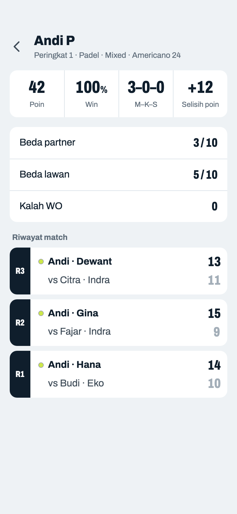
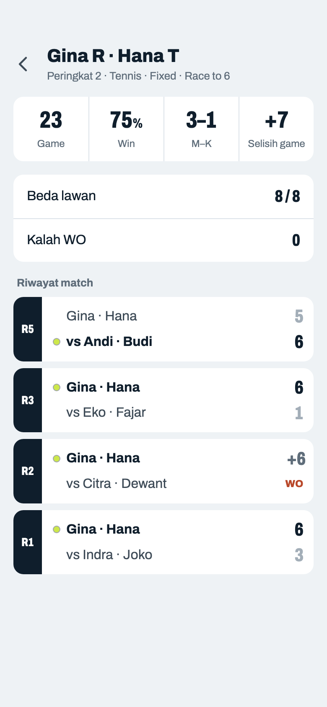
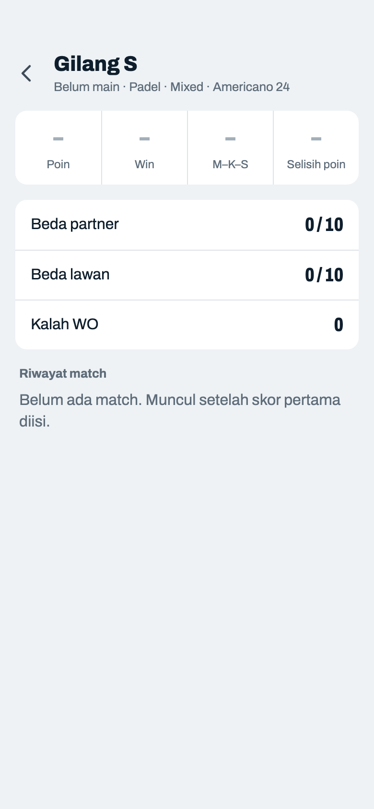

# Detail

> Dihasilkan `tool/hifi_extract.py` dari `design/hifi.html`. Jangan diedit langsung.

Satu baris angka menggantikan lima kotak statistik. Riwayat match memakai bentuk baris yang sama dengan Jadwal.

## 10a · Pemain · Mixed

Komponen: `MabarAppBar`, `MabarIconButton`, `MabarGroup / MabarRow`, `MatchScoreRow`, `StatLine`

- Avatar inisial bergradien dihapus. Subjudul: peringkat · olahraga · mode · format skor. Angka mengikuti metode yang dipilih di Peringkat.
- Label statistik mengikuti format skor, bukan mode: "Poin" / "Selisih poin" untuk Americano, "Game" / "Selisih game" untuk Race to dan Best of; M–K–S hanya kalau format bisa seri, selain itu M–K (10b). Format di subjudul yang menjelaskan kenapa labelnya berbeda.
- "Beda partner/lawan" dibanding semua pemain lain (termasuk yang keluar). "Kalah WO" tetap.
- Riwayat: terbaru di atas. Baru: Mixed menampilkan partner di tiap match. Baris atas selalu tim pemain ini, ditulis seperti Fixed (10b): nama sendiri dulu lalu partner ("Andi · Dewant"), lawan di baris bawah dengan "vs". Hasil: tebal + bola = menang, pudar = kalah, "Seri", "WO" (menang/kalah). Match kosong dan tidak dimainkan tidak masuk. Tidak bisa diketuk.

## 10b · Pasangan · Fixed

Komponen: `MabarAppBar`, `MabarIconButton`, `MabarGroup / MabarRow`, `MatchScoreRow`, `StatLine`

- Baru: judul berisi kedua nama pasangan. Sekarang hanya nama anggota pertama yang tampil dan anggota kedua tidak bisa dibuka.
- "Beda partner" disembunyikan di Fixed karena selalu 1.
- Pada riwayat Fixed, baris atas selalu pasangan ini (tebal kalau menang).
- Menang WO menulis tambahan game/poinnya dengan warna pudar ("+6"), supaya jumlah riwayat cocok dengan angka di atas: 5 + 6 + 6 + 6 = 23. Selisih tidak berubah (+7).

## 10c · Belum ada match

Komponen: `MabarAppBar`, `MabarIconButton`, `MabarGroup / MabarRow`, `StatLine`

- Kotak info abu-abu diganti satu kalimat. Pemain tidak ditemukan / tidak ada turnamen: teks tengah "Belum ada turnamen berjalan".
