# Bagikan

> Dihasilkan `tool/hifi_extract.py` dari `design/hifi.html`. Jangan diedit langsung.

Kartu pratinjau, pilihan tema dan format, lalu dua gambar (Feed 1:1 dan Story 9:16) dibagikan lewat share sheet sistem dengan teks hasil sebagai caption.

## 11a · Ringkas · tema biru · bernama

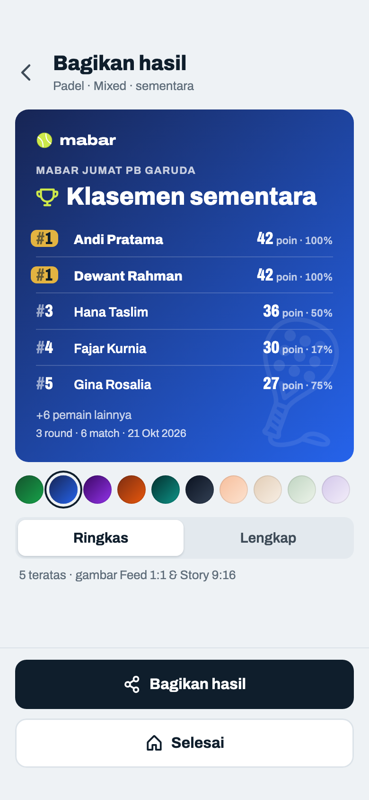

Komponen: `MabarAppBar`, `MabarButton`, `MabarIconButton`, `MabarActionBar`, `MabarGroup / MabarRow`, `MabarSegmented`, `SharePoster`

- Baru: subjudul dan judul kartu mengikuti status sebenarnya ("sementara" / "akhir"). Sekarang badge FINAL di-hardcode.
- Wordmark + bola menggantikan "MABAR TURNAMEN · PADEL". Piala tetap (ikon, bukan emoji) berwarna bola di tema gelap, tinta tema di tema lembut. Watermark raket mengikuti olahraga (padel diputar 20°).
- Nilai per baris: Total Point → "42 poin · 100%"; Win % → "100% · +12". Nama lengkap, terpotong elipsis.
- 10 tema; default biru (dulu hijau). Pilihan tema & format tidak disimpan.
- "Selesai" memindahkan turnamen ke slot terakhir lalu ke Beranda (stack di-reset), tanpa konfirmasi. Footer "Hasil turnamen tersimpan otomatis" dihapus.
- Turnamen bernama: nama menggantikan "PADEL · MIXED · 21 OKT 2026" di baris kecil di atas judul (kapital, gaya sama, maks dua baris) dan tanggal pindah ke ringkasan bawah, sama dengan baris akhir caption. Olahraga terbaca dari watermark, Fixed/Mixed dari isi daftar. Tanpa nama: baris kecil tetap "olahraga · mode · tanggal" (11b, 11e).
- Caption: baris pertama "🏆 {nama} · Padel"; tanpa nama "🏆 Mabar Turnamen · Padel".

## 11b · Lengkap · Fixed 20 pemain (10 pasangan) · tema peach

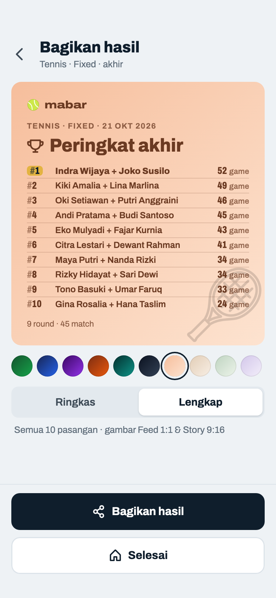

Komponen: `MabarAppBar`, `MabarButton`, `MabarIconButton`, `MabarActionBar`, `MabarGroup / MabarRow`, `MabarSegmented`, `SharePoster`

- Fixed 20 pemain = 10 pasangan, round-robin 45 match (5 court, 9 round). Lengkap memuat 10 baris dalam satu kolom; baris berbagi tinggi kartu yang tersisa, nama lengkap kedua anggota dipisah "+", terpotong elipsis kalau panjang. Lebih dari 10 pasangan tetap satu kolom dengan huruf lebih kecil (11k).
- Pratinjau memakai tata letak gambar Feed 1:1; gambar Feed dan Story-nya di 11g.
- Tema lembut memakai tinta gelap tema itu untuk semua teks, garis, piala, dan watermark (tidak ada `Colors.white` langsung).
- Baru: di Fixed hitungannya "pasangan", bukan "pemain" (juga di "+n pasangan lainnya").

## 11c · Gagal share · hasil disalin

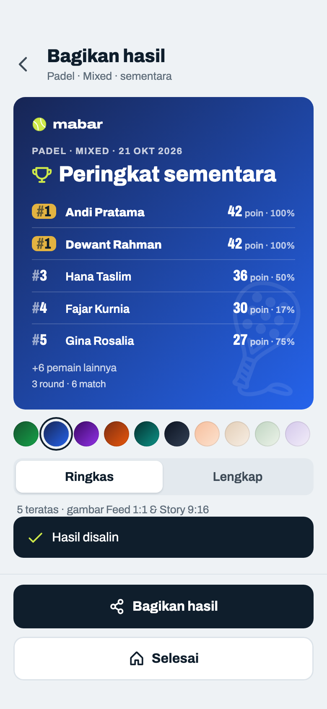

Komponen: `MabarAppBar`, `MabarButton`, `MabarIconButton`, `MabarActionBar`, `MabarGroup / MabarRow`, `MabarSegmented`, `MabarToast`, `SharePoster`

- Saat merender dua poster, tombol mati dengan teks "Menyiapkan gambar…" (ketukan ganda diabaikan). Frame ini menggambar momen sesudahnya: tombol aktif lagi dan toast tampil (keputusan host 2026-10-22).
- Toast selalu 19 pt di atas action bar, seperti posisi bawaannya. Di sini action bar berisi dua tombol (161 pt), jadi bawah toast di 180 pt; posisi bawaan 118 pt untuk action bar satu tombol akan menutupi "Bagikan hasil" (keputusan host 2026-10-22).
- Kalau share sheet gagal (desktop/web tertentu), caption disalin ke clipboard dan muncul toast "Hasil disalin". Tidak ada tombol salin terpisah.
- Caption: semua baris peringkat; format Lengkap menambah "Hasil per Round". Baru: satuan "game"/"poin" mengikuti metode skor.

## 11d · Gambar yang dibagikan · Feed 1080×1080 dan Story 1080×1920 (skala 1:3) · nama 40 karakter

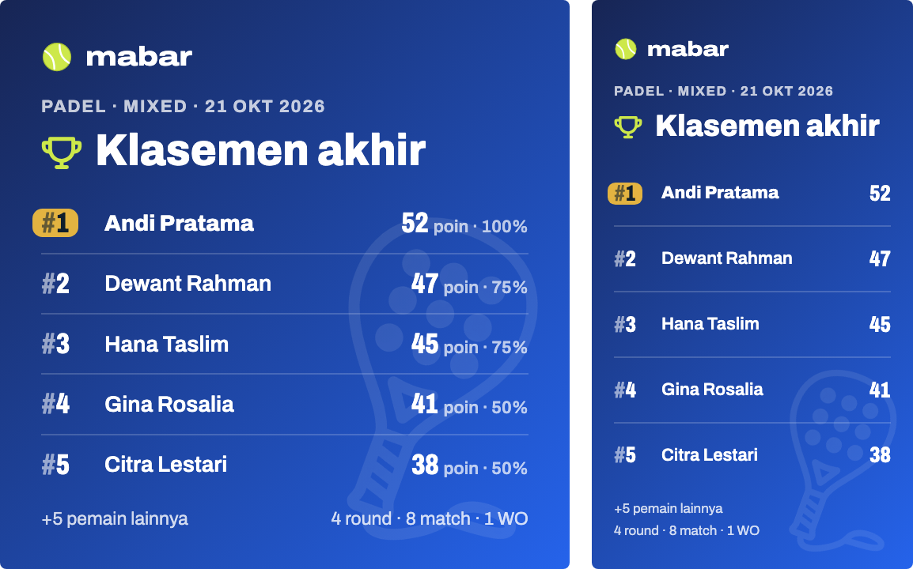

Komponen: `SharePoster`

- Baris membagi tinggi yang tersisa sama rata, jadi daftar selalu mengisi poster; baris mengecil kalau banyak (format Lengkap). Ukuran huruf dan margin per gambar ada di preset komponen `SharePoster` (`SharePosterTarget` pratinjau / Feed / Story).
- File: `mabar-feed-1080x1080.png`, `mabar-story-1080x1920.png`, dibagikan bersamaan lewat `Share.shareXFiles`.
- Render poster di test wajib memuat font Archivo (`loadHifiFonts()`), jangan percaya font Ahem.
- Nama terpanjang (40 karakter): Feed satu baris, Story dua baris; daftar di bawahnya berbagi tinggi yang tersisa.

## 11e · Lengkap · Mixed 20 pemain · tema biru

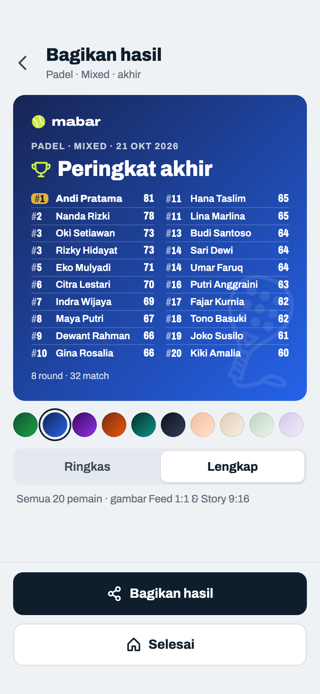

Komponen: `MabarAppBar`, `MabarButton`, `MabarIconButton`, `MabarActionBar`, `MabarGroup / MabarRow`, `MabarSegmented`, `SharePoster`

- 20 baris tidak terbaca dalam satu kolom 1:1, jadi lebih dari 10 pemain dibagi dua kolom rata: ⌈n/2⌉ di kiri, sisanya di kanan, urut ke bawah dulu seperti daftar Pemain (20 → 10–10, 12 → 6–6 di 11h, 13 → 7–6 di 11i, 30 → 15–15 di 11l; ≤ 10 tetap satu kolom). Pasangan Fixed tidak pernah dua kolom (11k). Bukan 10 di kiri lalu sisanya, supaya kolom kanan tidak setengah kosong.
- Dalam dua kolom tiap baris hanya nama dan nilai metode; "poin · %" dihapus karena tidak muat di setengah lebar.
- Nomor sama untuk statistik identik tetap berlaku (3, 3 · 11, 11 · 14, 14).
- Data: Americano 21, 4 court × 8 round = 32 match, tiap pemain main 6–7 kali.

## 11f · Gambar Lengkap · Mixed 20 pemain · Feed dan Story (skala 1:3) · bernama

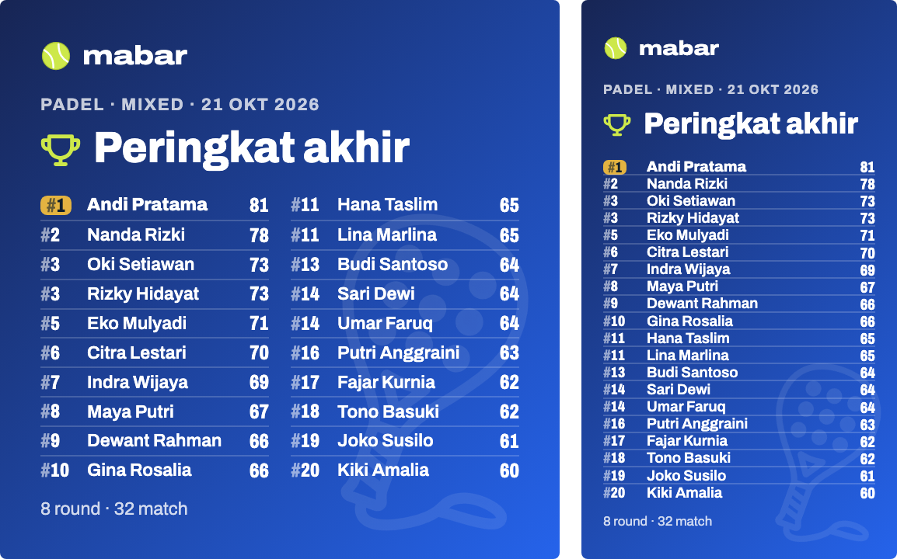

Komponen: `SharePoster`

- Feed 1:1: dua kolom rata karena lebih dari 10 baris (pembagian sama dengan pratinjau, 11e/11h); tiap baris di 1080 px ±45 px tinggi, sama terbacanya dengan Ringkas.
- Story 9:16: satu kolom 20 baris; tinggi kanvas cukup (±60 px per baris di 1080×1920). Hanya nilai metode, tanpa "poin · %".
- Story memuat 20 baris nama di ukuran ini (Mixed 20 pemain, atau Fixed 10 pasangan bertumpuk di 11g). Lebih dari itu semua huruf baris dikecilkan sebanding: 30 baris nama → 20/30 (11k, 11l).

## 11g · Gambar Lengkap · Fixed 10 pasangan · Feed dan Story (skala 1:3)

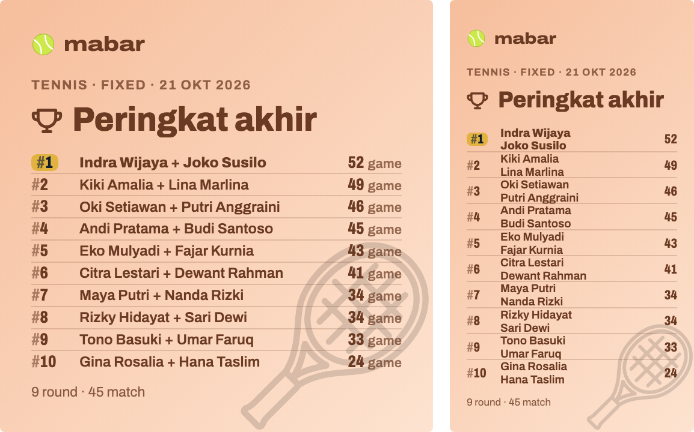

Komponen: `SharePoster`

- Pasangan selalu satu kolom, juga di Feed, supaya nama lengkap kedua anggota muat dalam satu baris; di setengah lebar nama kedua terpotong habis. Lebih dari 10 pasangan: 11k.
- Story lebih sempit, jadi nama pasangan ditumpuk dua baris (seperti tabel Klasemen 09c) supaya tidak terpotong.

## 11h · Lengkap · Mixed 12 pemain · dua kolom 6–6

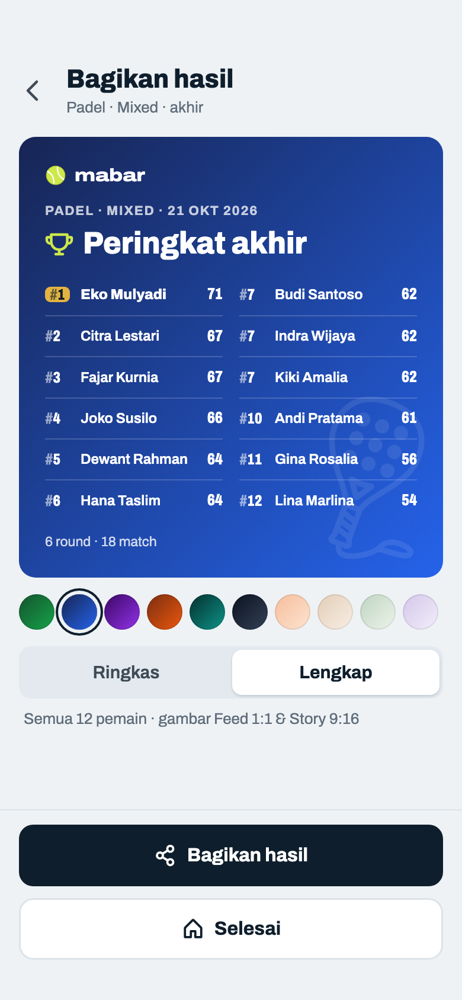

Komponen: `MabarAppBar`, `MabarButton`, `MabarIconButton`, `MabarActionBar`, `MabarGroup / MabarRow`, `MabarSegmented`, `SharePoster`

- 12 baris → dua kolom rata 6–6 (1–6 kiri, 7–12 kanan), bukan 10–2. Baris lebih tinggi daripada 20 pemain karena tetap membagi tinggi kartu yang sama.
- Data: Americano 21, 3 court × 6 round = 18 match, semua pemain main tiap round.

## 11i · Lengkap · Mixed 13 pemain (ganjil) · 7–6

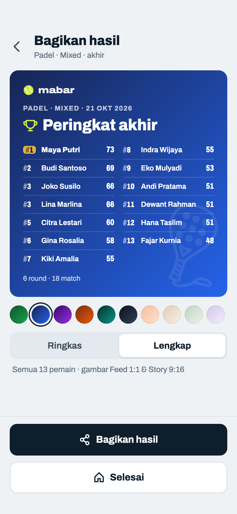

Komponen: `MabarAppBar`, `MabarButton`, `MabarIconButton`, `MabarActionBar`, `MabarGroup / MabarRow`, `MabarSegmented`, `SharePoster`

- Jumlah ganjil: kolom kiri dapat kelebihan satu (11 → 6–5, 13 → 7–6). Kedua kolom memakai tinggi baris yang sama (grid ⌈n/2⌉ baris), jadi baris kiri dan kanan sejajar dan slot terakhir kanan kosong, bukan baris kanan yang meregang.
- 7 dan 9 pemain (≤ 10 baris) tetap satu kolom, seperti Fixed 11b.
- Data: Americano 21, 3 court × 6 round = 18 match; tiap round 1 pemain istirahat, jadi ada yang main 5 dan 6 kali.

## 11j · Lengkap Mixed · semua jumlah ganjil 5–19 (skala 1:2)

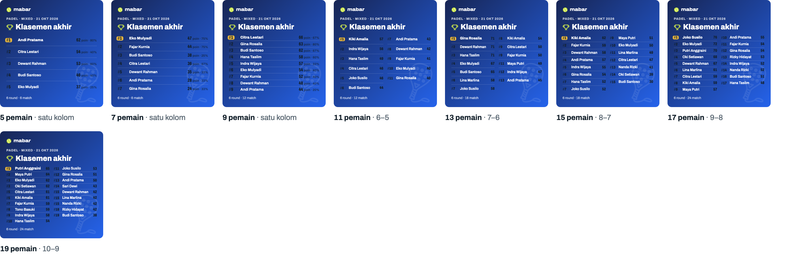

Komponen: `SharePoster`

- Sampai 10 baris satu kolom dengan "poin · %"; 11 ke atas dua kolom rata, kiri dapat kelebihan satu: 11 → 6–5, 13 → 7–6, 15 → 8–7, 17 → 9–8, 19 → 10–9.
- Baris kiri dan kanan selalu sejajar; slot terakhir di kanan kosong. Makin sedikit baris, makin tinggi tiap baris (tetap membagi tinggi kartu), jadi 5 pemain terlihat lega dan 19 pemain sama padatnya dengan 20.
- Nomor diberi "#" pudar di semua kartu dan gambar, supaya "#3" tidak tertukar dengan angka poin di ujung baris.
- Semua baris peringkat 1 diberi lencana emas `#E3B341` dengan tulisan tinta, dan namanya lebih tebal. Kalau ada dua #1 (statistik identik), keduanya dapat lencana.

## 11k · Gambar Lengkap · Fixed 30 pemain (15 pasangan) · Feed, Story (skala 1:3) dan pratinjau

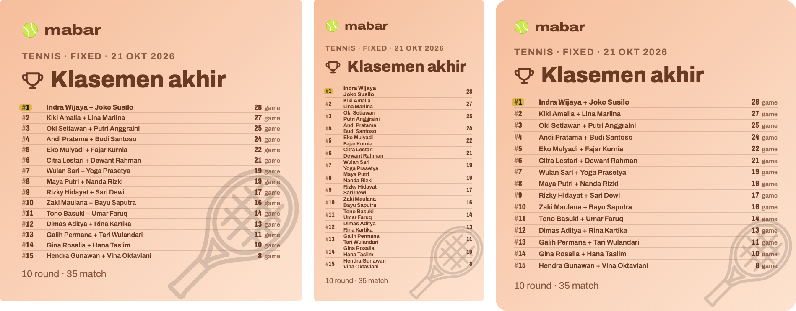

Komponen: `SharePoster`

- Pasangan selalu satu kolom: Feed dan pratinjau satu baris per pasangan dengan nama lengkap kedua anggota, Story menumpuk nama dua baris (30 baris nama).
- Lebih padat dari frame terpadat yang disetujui (satu kolom 10 baris di 11b/11g, 20 baris nama di Story 11g), jadi semua huruf baris dikecilkan sebanding: 15 pasangan → 10/15 di Feed dan pratinjau, 30 baris nama → 20/30 di Story. Wordmark, judul, dan kaki tetap.
- Data: Tennis Race to 6, 4 court, diakhiri setelah 10 round · 35 match (round-robin penuh 105 match).

## 11l · Gambar Lengkap · Mixed 30 pemain · Feed, Story (skala 1:3) dan pratinjau

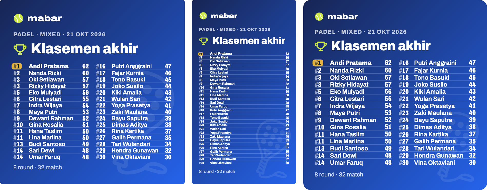

Komponen: `SharePoster`

- Feed dan pratinjau: dua kolom 15–15 di ukuran 11e/11f, tidak dikecilkan; 15 baris per kolom masih terbaca.
- Story: 30 baris satu kolom, semua huruf baris dikecilkan 20/30 (±6,3 pt di kanvas 203 pt, ±12 pt saat Story dibuka layar penuh di HP).
- Data: Americano 21, 4 court × 8 round = 32 match, tiap pemain main 4–5 kali.
