# Live score

> Dihasilkan `tool/hifi_extract.py` dari `design/hifi.html`. Jangan diedit langsung.

Host menyalakan live dari menu ⋯ Jadwal (Fixed dan Mixed) lalu membagikan link; pemain lain membuka Jadwal, Klasemen, dan Detail di browser dalam mode baca saja, diperbarui setiap kali turnamen berubah. Tanpa database: relay hanya memegang salinan turnamen terakhir per kode live (logic.md §11). Contoh host: Padel, Americano 21, 10 pemain, R4 baru dibuat (latar 06h). Contoh penonton: data 06f, 06a, 09a, 10a, 06m.

## 12a · Menu ⋯ · Mixed · live belum aktif

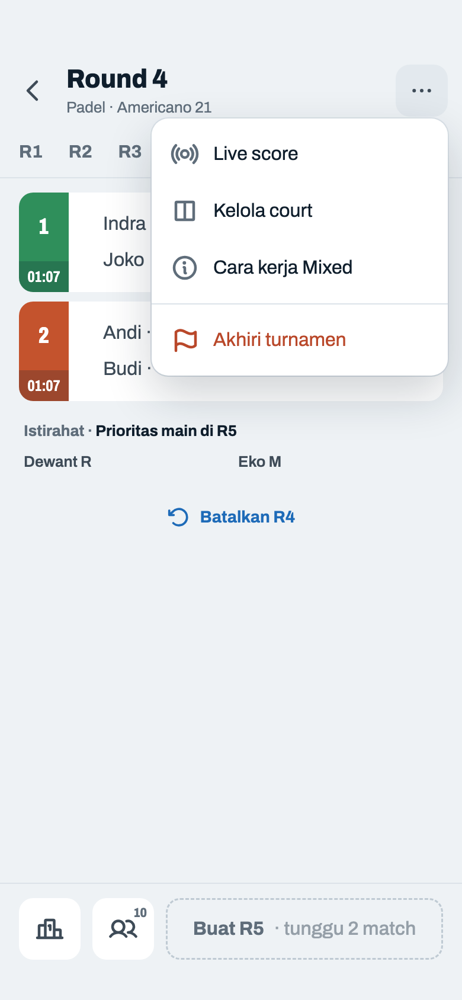

Komponen: `MabarAppBar`, `MabarButton`, `MabarIconButton`, `MabarActionBar`, `MabarGroup / MabarRow`, `MabarGroupHeader`, `RoundTabs`, `MatchScoreRow`, `RestingList`, `MabarMenu`

- Item paling atas: "Live score", ikon `broadcast`. Ada di Fixed (06d) dan Mixed (06i), juga setelah diakhiri (12f).
- Live tidak menambah elemen di layar Jadwal, sama seperti Kelola court.
- Belum aktif → dialog 12b. Sudah aktif → langsung sheet 12c.

## 12b · Dialog · mulai live

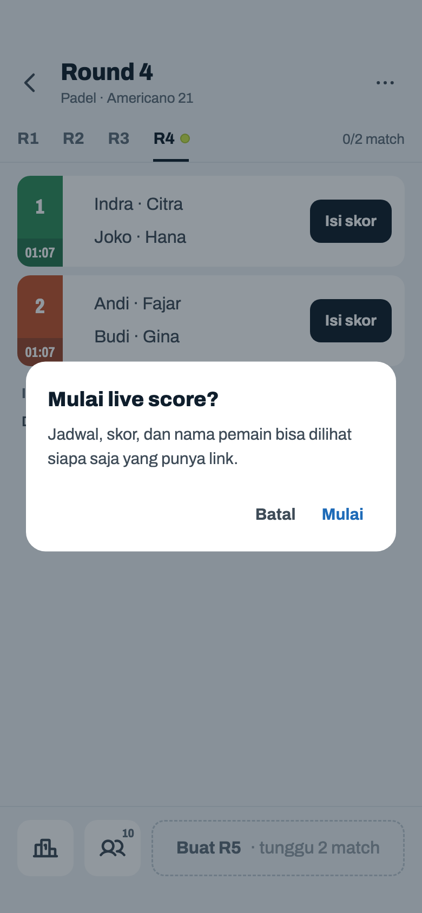

Komponen: `MabarAppBar`, `MabarButton`, `MabarTextButton`, `MabarIconButton`, `MabarActionBar`, `MabarGroup / MabarRow`, `MabarGroupHeader`, `RoundTabs`, `MatchScoreRow`, `RestingList`, `showMabarSheet`, `showMabarConfirm`

- Akibatnya ditulis di dialog, bukan di sheet: nama pemain keluar dari HP host.
- "Mulai" butuh internet sekali untuk membuat kode live. Gagal → toast 12g, live tidak menyala.
- Berhasil → sheet 12c terbuka.

## 12c · Sheet · live aktif · terkirim

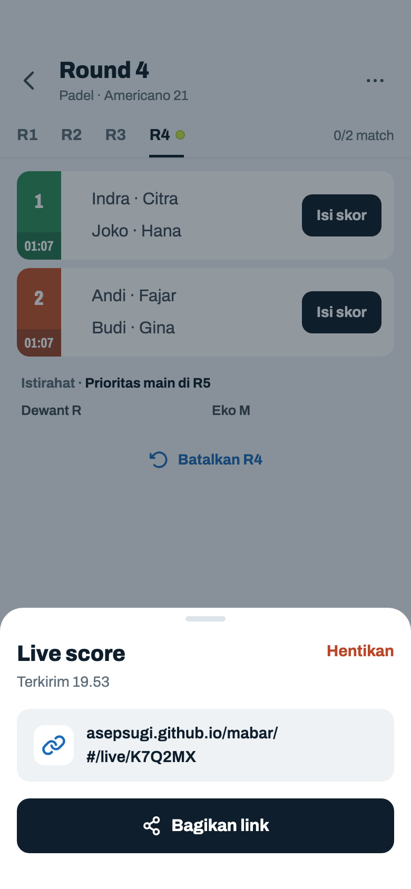

Komponen: `MabarAppBar`, `MabarButton`, `MabarTextButton`, `MabarIconButton`, `MabarActionBar`, `MabarGroup / MabarRow`, `MabarGroupHeader`, `RoundTabs`, `MatchScoreRow`, `RestingList`, `showMabarSheet`, `HomePanel / SportPicker`, `LiveScoreSheet`

- Subjudul = jam kiriman terakhir yang berhasil. Tiap perubahan (skor, round baru, pemain, court, Akhiri) langsung dikirim.
- "Bagikan link" → share sheet sistem dengan teks "Live score Rabu Padel Matcha Club" + link (tanpa nama turnamen: "Live score Padel"). Share gagal (browser lama) → link disalin + toast "Link disalin", seperti Bagikan poster.
- Kode 6 karakter tanpa huruf yang mirip (0/O, 1/I/L). Satu turnamen satu kode; resume dari Beranda memakai kode yang sama.
- "Hentikan" di kanan atas seperti Hapus di detail court (08h) → dialog 12e.

## 12d · Sheet · menunggu internet

Komponen: `MabarAppBar`, `MabarButton`, `MabarTextButton`, `MabarIconButton`, `MabarActionBar`, `MabarGroup / MabarRow`, `MabarGroupHeader`, `RoundTabs`, `MatchScoreRow`, `RestingList`, `showMabarSheet`, `HomePanel / SportPicker`, `LiveScoreSheet`

- Setiap kiriman membawa seluruh turnamen, jadi tidak ada antrean: begitu ada sinyal, yang terkirim langsung keadaan terbaru. Dicoba lagi tiap 30 detik dan setiap ada perubahan.
- Selama ini penonton tetap melihat data 19.48.
- Turnamen di HP host tetap jalan offline seperti biasa.

## 12e · Dialog · hentikan live

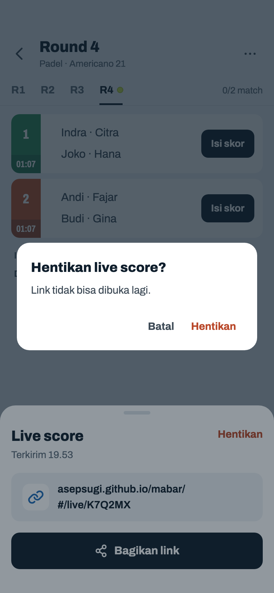

Komponen: `MabarAppBar`, `MabarButton`, `MabarTextButton`, `MabarIconButton`, `MabarActionBar`, `MabarGroup / MabarRow`, `MabarGroupHeader`, `RoundTabs`, `MatchScoreRow`, `RestingList`, `showMabarSheet`, `showMabarConfirm`, `HomePanel / SportPicker`, `LiveScoreSheet`

- Dialog muncul di atas sheet 12c; Batal kembali ke sheet. Data live di server dihapus saat itu juga dan sheet tertutup; penonton melihat 12n.
- Bisa dimulai lagi lewat menu, tapi dapat link baru.
- "Hapus & mulai baru" di Beranda (01h) juga menghentikan live turnamen yang dihapus.

## 12f · Menu ⋯ · Fixed · diakhiri · live aktif

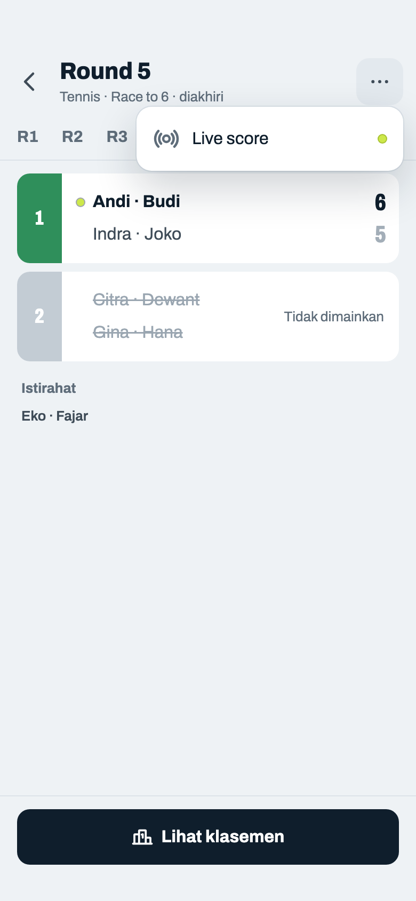

Komponen: `MabarAppBar`, `MabarButton`, `MabarIconButton`, `MabarActionBar`, `MabarGroup / MabarRow`, `MabarGroupHeader`, `RoundTabs`, `MatchScoreRow`, `RestingList`, `MabarMenu`

- Titik bola di ujung item = live sedang aktif.
- ⋯ di Fixed yang sudah diakhiri tetap aktif (06c): menunya berisi Live score.
- Live tetap jalan setelah Akhiri dan setelah "Selesai" di Bagikan, jadi penonton melihat hasil Final (12l). Dihapus otomatis 3 hari setelah perubahan terakhir.
- Fixed yang masih berjalan: Live score lalu garis, lalu Akhiri turnamen.

## 12g · Toast · gagal mulai

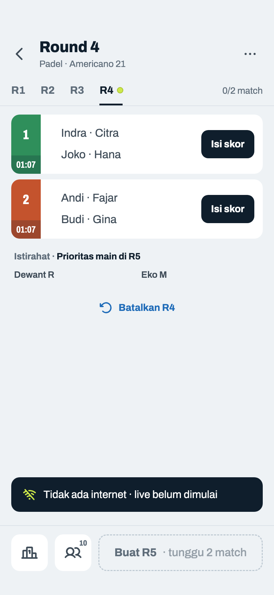

Komponen: `MabarAppBar`, `MabarButton`, `MabarIconButton`, `MabarActionBar`, `MabarGroup / MabarRow`, `MabarGroupHeader`, `RoundTabs`, `MatchScoreRow`, `RestingList`, `MabarToast`

- Satu-satunya saat live butuh internet di HP host. Setelah menyala, sinyal putus hanya menunda kiriman (12d).
- Toast 19 pt di atas action bar, sama dengan "Hasil disalin" (11c).

## 12h · Live · Jadwal Mixed · bernama

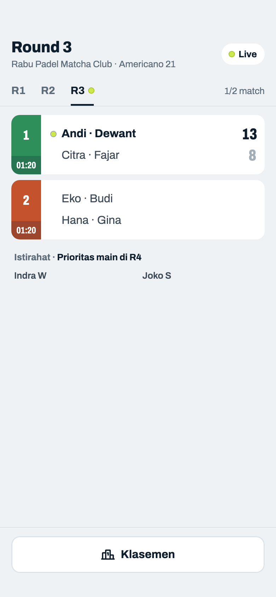

Komponen: `MabarAppBar`, `MabarButton`, `MabarActionBar`, `MabarGroup / MabarRow`, `MabarGroupHeader`, `RoundTabs`, `MatchScoreRow`, `RestingList`, `LiveTag`

- Halaman ini web Mabar yang sama (`asepsugi.github.io/mabar/#/live/K7Q2MX`) dalam mode baca saja: dibuka di browser, tanpa pasang app. Datanya tidak pernah menimpa turnamen di HP penonton sendiri.
- Beda dengan host: tanpa tombol kembali, ⋯ diganti tag "Live", match kosong tanpa "Isi skor", baris tidak bisa diketuk, tanpa Batalkan, Pemain, dan Buat round. Action bar tinggal Klasemen.
- Subjudul: nama turnamen menggantikan olahraga kalau ada (seperti Beranda); tanpa nama sama dengan host (12i).
- Dicek tiap 10 detik selama halaman terbuka; berhenti saat tab di belakang dan langsung dicek lagi saat dibuka. Hitung mundur court jalan sendiri dari jam mulai turnamen.
- Tab default sama dengan host. Round baru muncul → ikut pindah kalau penonton sedang di round terakhir; kalau sedang melihat round lain, tetap di situ.
- Istirahat · Prioritas main di R4 tetap tampil: pemain bisa tahu kapan main.

## 12i · Live · Jadwal Fixed · tanpa nama

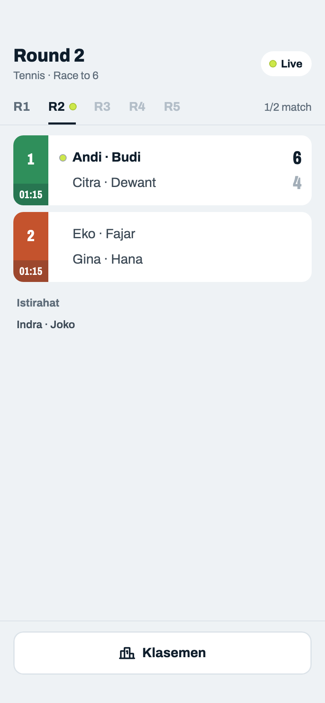

Komponen: `MabarAppBar`, `MabarButton`, `MabarActionBar`, `MabarGroup / MabarRow`, `MabarGroupHeader`, `RoundTabs`, `MatchScoreRow`, `RestingList`, `LiveTag`

- Fixed: semua round sudah ada sejak awal, round terkunci tetap bisa dibuka untuk melihat lawan.
- Action bar Klasemen sama dengan host (06a).

## 12j · Live · Klasemen

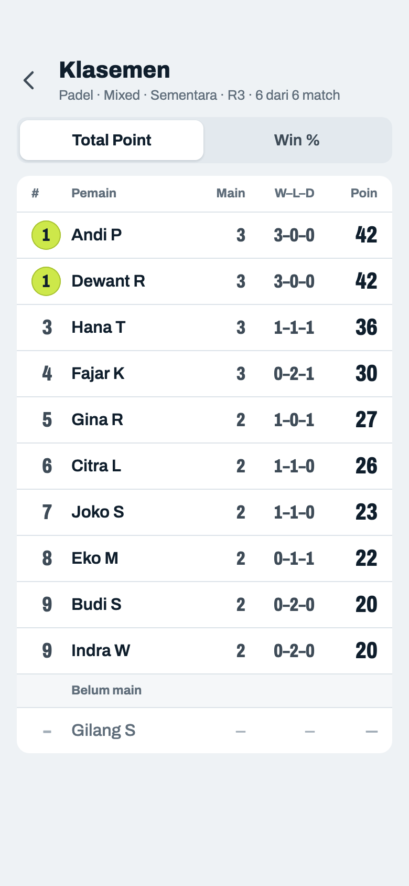

Komponen: `MabarAppBar`, `MabarIconButton`, `MabarSegmented`, `StandingTable`

- Sama dengan host minus Bagikan, dan tanpa tag: subjudulnya panjang, dan tag ada di Jadwal tempat penonton datang dan kembali. Isinya tetap ikut diperbarui. Metode (Total Point / Win %) dipilih sendiri oleh tiap penonton, tidak ikut pilihan host.
- Baris diketuk → Detail (12k). Kembali → Jadwal.

## 12k · Live · Detail pemain

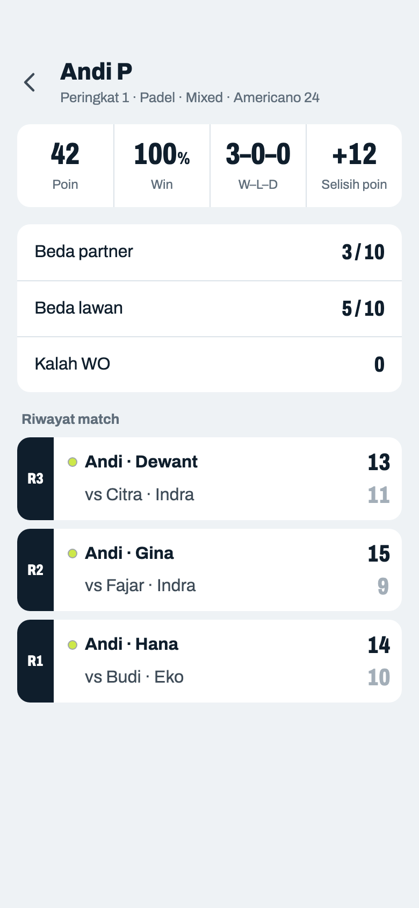

Komponen: `MabarAppBar`, `MabarIconButton`, `MabarGroup / MabarRow`, `MatchScoreRow`, `StatLine`

- Sama persis dengan Detail host (10a/10b/10c), tanpa tag seperti Klasemen; ikut diperbarui saat ada skor baru.

## 12l · Live · diakhiri

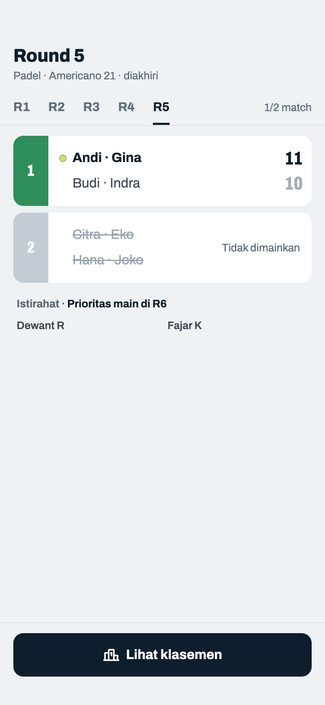

Komponen: `MabarAppBar`, `MabarButton`, `MabarActionBar`, `MabarGroup / MabarRow`, `MabarGroupHeader`, `RoundTabs`, `MatchScoreRow`, `RestingList`

- Final (diakhiri, atau syarat Final 09f/09c): tag "Live" hilang, "Lihat klasemen" jadi tombol utama seperti host Fixed (06c).
- Tetap dicek tiap menit: kalau host Lanjutkan (Mixed), tag dan jadwal kembali.

## 12m · Live · HP penonton offline

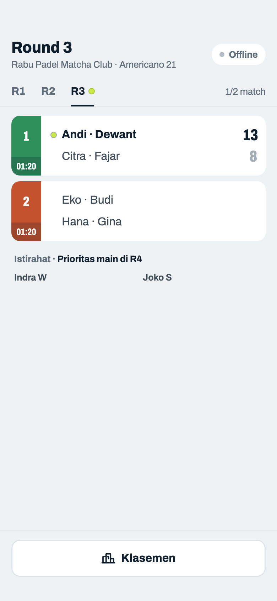

Komponen: `MabarAppBar`, `MabarButton`, `MabarActionBar`, `MabarGroup / MabarRow`, `MabarGroupHeader`, `RoundTabs`, `MatchScoreRow`, `RestingList`, `LiveTag`

- Cek gagal dua kali berturut-turut (±20 detik) → tag "Offline" abu-abu; data terakhir tetap tampil. Kembali "Live" begitu cek berhasil.
- Host yang offline tidak kelihatan dari sini: jadwal hanya berhenti berubah (12d).

## 12n · Live · link tidak ditemukan

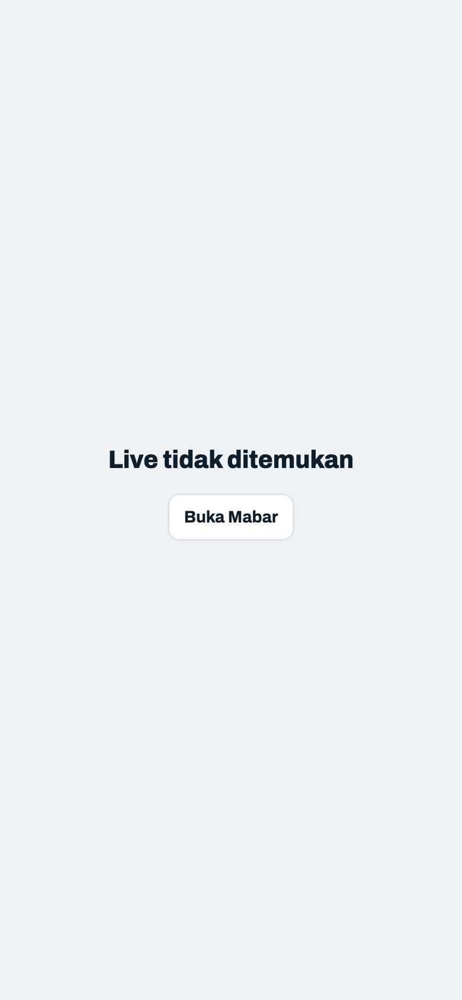

Komponen: `MabarAppBar`, `MabarButton`, `LiveScreen`

- Untuk link salah, live yang dihentikan (12e), dan live yang terhapus otomatis (3 hari tanpa perubahan).
- Data dari versi app host yang tidak bisa dibaca (beda `schemaVersion`): judul "Live tidak bisa dibuka", tombol sama.
- "Buka Mabar" → Beranda, jadi penonton bisa memakai Mabar sendiri.

## 12o · Live · memuat

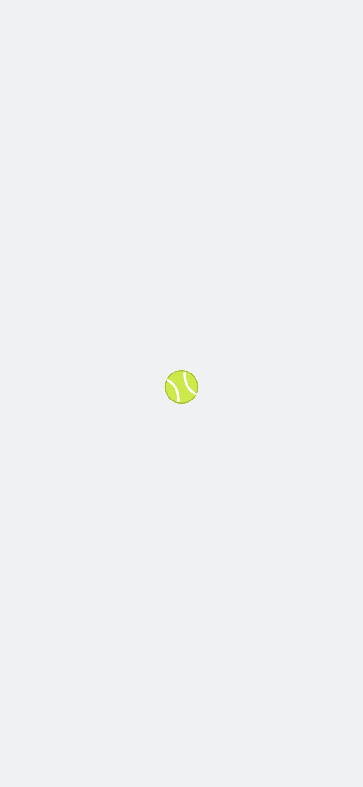

Komponen: `MabarAppBar`, `LiveScreen`

- Saat web dimuat dan cek pertama belum kembali. Bola yang sama dengan wordmark, berputar.
